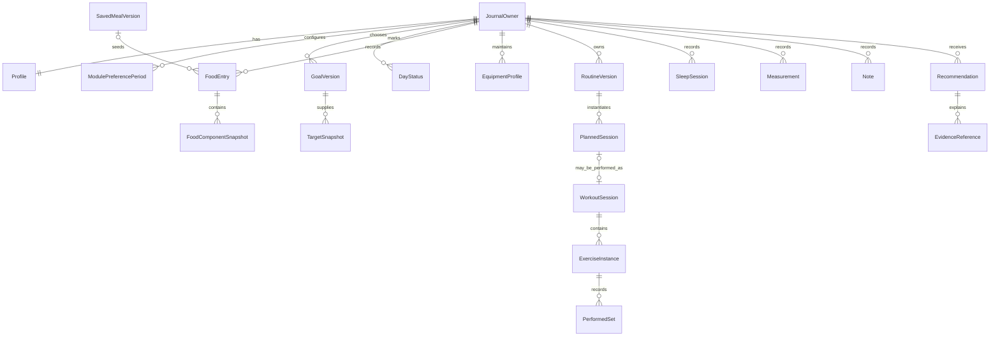

# Adaptive Health App: Product Analysis and Technology Architecture Decision

**Analysis date:** 11 October 2026

**Status:** Analysis complete; technical recommendations and open owner decisions await approval before the architecture stage.

**Deliverable boundary:** This document only. No application, dependency installation, prototype, infrastructure, or additional project documents have been created.

## 1. Executive summary

Build a functional, responsive website first, using **Expo, React Native, React Native Web, Expo Router, and strict TypeScript**. Keep Android build compatibility under test from the first implementation milestone; defer Android product release and store publication. Use a small monorepo with a universal application, an independent **Fastify modular API**, and shared domain logic and contracts. Recommend **PostgreSQL with Drizzle** on the server, **Dexie/IndexedDB on web**, and **Expo SQLite on Android**. One shared repository contract and synchronization protocol connect the two local implementations.

The product is an adult wellness companion for food, training, sleep, and practical next actions. Its first release should demonstrate a trustworthy imperfect week: log offline, resume interrupted work, move a workout, correct yesterday, understand incomplete evidence, and choose a manageable next action. Its value is not a global health score or unrestricted AI coach. The blueprint's intelligence depends on trustworthy records, explicit user control, and honest uncertainty [PDF pp. 1–2, 12, 18–19, 22–23].

The owner has confirmed **a small adult pilot, local guest logging with optional accounts and synchronization, Bangladesh-first food validation, an English interface, Bangla-English food-entry examples, and optional AI within MVP**. These choices supplement the PDF; they are not retroactively attributed to it. A guest must be able to save without an account or live server. Account creation offers an explicit, retryable import of local records.

Prefer Expo over Next.js with Capacitor because the requested future Android product should reuse application screens and deliver native integrations without replacing a DOM-based UI. This is a project-specific tradeoff, not a claim that Expo produces the best website in every case. Next.js with Capacitor is a credible alternative if early testing demonstrates materially better browser usability with acceptable Android behavior. Separate clients remain a fallback when universal UI compromises outweigh shared-screen savings.

The most consequential recommendations are:

- Local records and a durable outbox own logging; a network cache is not the database. Saving must not depend on AI, authentication refresh, or background execution.
- Nutrient arithmetic, dates, target comparisons, workout state transitions, and aggregates remain deterministic and shared. AI can propose matches and explain supplied evidence, not manufacture authoritative values.
- Goal versions, daily target snapshots, nutrient snapshots, and workout plan snapshots preserve history. Unknown data remains unknown.
- Implement a bounded synchronization protocol with idempotency, explicit edit conflicts, account isolation, and deletion propagation. Do not hide its engineering cost.
- Use paid managed API/database hosting for the first persistent real-data pilot when the owner accepts its budget; keep free local development and a documented VPS alternative. See section 12 for dated cost assumptions.
- Browser storage confidentiality, clinical policy review, regional content licensing, operating budget, and retention commitments are approval gates. The analysis does not pretend that these are settled by a framework choice.

No runtime compatibility, performance, recovery, or clinical validation has been performed at this stage. The tests below are future requirements, not passing results.

## 2. Authoritative sources and assumptions

### 2.1 Source authority and verification

The authoritative product source is [Adaptive Health App Product Blueprint](Adaptive_Health_App_Product_Blueprint.pdf), **24 pages**, reviewed in full, including its tables, calendar illustration, roadmap, technical notes, and validation scenarios. Page references throughout this document use the PDF's physical/printed page numbers 1–24, not its section numbers. Its SHA-256 at analysis time is `31c85d96fa511dbd3b9243612254b6fb7d8c15200e644ed3fd57dfe78a25b358`.

The owner's task and approved approach govern delivery constraints. Where the blueprint's narrative and roadmap differ, p. 19 is the proposed MVP baseline, pp. 20–21 define later investments, and p. 23 describes the finished experience. This precedence is an explicit interpretation, not a change to the source PDF.

External links in this document are official project, platform, publisher, or institutional sources reviewed on **2026-10-10**, unless explicitly marked otherwise. They support adjacent factual claims; recommendations, reuse percentages, budgets, and architectural judgments are labeled as estimates or engineering proposals. The PDF's own statement that sources were checked on 1 October 2026 is separate from this review. Documentation availability does not establish that a dependency combination has been tested in this repository.

Medical background remains background: [NIDDK's planner](https://www.niddk.nih.gov/bwp), the [ISSN protein position stand](https://link.springer.com/article/10.1186/s12970-017-0177-8), and [CDC sleep guidance](https://www.cdc.gov/sleep/about/index.html) do not determine this application's policy thresholds or validate its outcomes. The [Mifflin publication link](https://pubmed.ncbi.nlm.nih.gov/2305711/) returned insufficient article content during this verification; the example equation below is attributed to PDF p. 5, not independently revalidated from that page. Competitor descriptions on PDF p. 24 are treated as the blueprint's limited market context, not a new market survey or proof of exclusivity.

### 2.2 Classification used throughout

| Label | Meaning |
| --- | --- |
| **P** | Directly supported by the PDF, with page references. |
| **U** | Explicit owner instruction or confirmed preference. |
| **E** | Proposed engineering or product interpretation; not a PDF fact. |
| **O** | Owner decision or external review still needed; see section 13. |
| **MVP** | Included in the proposed first pilot release. |
| **Later** | Product requirement or enhancement retained for after MVP. |
| **Research** | Hypothesis or technical exploration with an evidence gate. |

Source and release status are independent: a feature can be directly supported by the PDF and still be post-MVP. An engineering requirement can be essential to MVP without appearing verbatim in the PDF.

### 2.3 Confirmed constraints and working defaults

| Item | Status and implication |
| --- | --- |
| Website first; Android later, verified early | U. Publish the working website first. Use real Android builds for compatibility evidence before major implementation investment. |
| Guest plus optional accounts | U. Local first save, explicit account import, backup/sync, export, account deletion, and account-switch isolation belong in the first pilot. |
| Bangladesh-first, English UI | U. Validate local foods, transliterations, Bengali script, and realistic portions; full bilingual UI is Later. English UI must still render Bangla food names correctly. |
| Optional MVP AI | U. Add bounded parsing and summaries after deterministic flows. Provider outage, budget exhaustion, or opting out cannot disable logging. |
| Small adult pilot | U. No invented participant count, clinical-effectiveness claim, or growth target. Pilot success thresholds come from observation. |
| Manual setup | U. Owner creates accounts, installs toolchains, configures environments, and approves paid services when instructed in a later stage. |
| Browser support | E/O1. Test current and previous major desktop Chrome/Edge, Firefox, Safari, and mobile Chrome/Safari where platform support permits. Record exact versions at the feasibility milestone. Android OS floor follows the selected Expo SDK/native plugins and owner devices, not an invented version today. |
| Package versions | E. At setup, select one mutually compatible stable Expo/React Native/React/tooling set, pin it in a lockfile, and record native plugin support. Do not independently select every package's latest version. |
| Scope not implied | No iOS release, social network, billing system, clinician dashboard, household sharing, or end-to-end cloud encryption commitment in MVP. These require separate decisions. |

## 3. Complete product requirements inventory

Each row states a user capability, its dependencies, and an observable acceptance condition or important edge. Requirement IDs remain stable if later reprioritized. The row's last column links the responsible architecture decisions; section 11 maps critical requirements to validation scenarios.

### 3.1 Product identity, audience, promise, and design principles

| ID / source / pages | Capability and interaction | Data dependencies and acceptance / edge cases | Release / ADR |
| --- | --- | --- | --- |
| R01 · P · 1–2, 24 | Adults managing weight or strength with irregular schedules can use Food, Workout, Sleep, or any combination. | Beginners and returning exercisers are initial audiences; no wearable prerequisite or claim to measure total health. One-module users remain first-class users. | MVP · D1, D10 |
| R02 · P · 1–3, 15 | Logging leads to understandable feedback and one realistic next step. | Reward returning and competence; do not optimize for punitive streaks, extreme intake/training, comparison leaderboards, or time spent in the app. | MVP principle · D3, D10 |
| R03 · P · 2–4, 12 | Users control goals, visible metrics, routines, recommendations, tone, and enabled modules. | Disabling a domain removes its prompts/evaluation contribution while preserving history; sparse evidence lowers confidence, not user standing. | MVP · D3, D8, D10 |
| R04 · P · 3, 15, 20–22 | Explore a busy-day simulation, persistent mosaic, and comeback milestones. | Simulations cannot mutate a real plan or log exercise until accepted; celebrations are optional and reduced-motion aware. Measure return and perceived pressure. | Later / Research · D10, D11 |

### 3.2 Shared onboarding and user profiles

| ID / source / pages | Capability and interaction | Data dependencies and acceptance / edge cases | Release / ADR |
| --- | --- | --- | --- |
| R05 · P · 4, 19 | Choose primary/optional secondary goal and enabled modules, preview assumptions, then save a first useful entry. | Progressive onboarding requests only missing relevant information. Enabling Workout after Food does not repeat answered questions. | MVP · D3, D8 |
| R06 · P · 4–5 | Reuse age, height, weight, units, time zone, and activity context where needed. | Sleep-only entry needs neither weight nor calorie target. Explain physiological formula input and offer manual targets when declined. | MVP · D8, D10 |
| R07 · P+U · 4, 19 | Save locally before account creation; optionally register or sign in for sync. | P makes guest access conditional; U selects it. E: offline guest save cannot depend on a server-created anonymous account; importing into an existing account is explicit. | MVP · D5–D7 |
| R08 · P · 4, 12–13 | Enable/disable modules; choose simple or detailed screens. | Keep tab order stable by default; optional compact hiding preserves access through settings/history. Re-enable restores preferences and checks old goals. Integration permissions are explained separately. | MVP · D3, D8, D11 |
| R09 · P · 4 | Universal Add offers Food, Workout, Sleep, Weight, and Note for enabled features. | Preserve selected journal date, show it before save, allow undo. E: minimal weight measurements and generic notes support this shortcut without creating extra main tabs. | MVP · D3, D8 |
| R10 · P · 4, 19 | Screen-reader labels, generous targets, non-color states, and reduced motion work throughout. | Simple/detailed toggles do not hide required error messages or change stored values; navigation and save flows work with keyboard and assistive technology. | MVP · D3, D11 |

### 3.3 Goals, targets, and progress bars

| ID / source / pages | Capability and interaction | Data dependencies and acceptance / edge cases | Release / ADR |
| --- | --- | --- | --- |
| R11 · P · 5, 19 | Show provisional maintenance/goal estimates with editable assumptions and manual targets. | Separate resting expenditure, activity-adjusted maintenance, and chosen target. Retain method/inputs/policy version. Do not double-add wearable exercise calories. Policy review gates automation. | MVP · D8, D10 |
| R12 · P · 5 | Negotiate target weight and optional deadline with ranges and alternatives. | Offer more time, revised target, or strength/consistency priority. Combined fat loss/muscle gain is an objective, not an exact body-composition forecast. No unreviewed linear timeline promise. | MVP discussion; prediction Later · D10 |
| R13 · P · 5–6 | Pin, remove, and reorder bars; default to at most two. | Weight loss: calories; combined/gain goals: calories and protein; maintenance: calories, optional protein; habit-only: selected behaviors with optional numeric hiding. Hidden nutrients remain recorded when known. | MVP · D3, D8, D11 |
| R14 · P · 5–7 | Show target zones and useful nutrient detail without rewarding excess. | Protein is contextual, not a universal prescription. Over-target calories do not create extra achievement; a complete food log is not the same as meeting a target. | MVP · D10, D11 |
| R15 · P · 7, 13, 18, 22 | Change goals without rewriting historical attainment. | Dated goal versions and daily snapshots survive historical entry edits. E: recommend next-journal-day changes and no retroactive target-policy changes in MVP, pending O3. | MVP · D8 |
| R16 · P · 5, 13–14, 22, 24 | Exclude unsupported automated prescriptions and offer logging/manual paths under reviewed policy. | Adult-scope eligibility; minors, pregnancy/breastfeeding, pain/illness, and individualized nutrition needs must not receive generic automated weight-change prescriptions. Bounds remain review decisions. | MVP safety; adaptive target review Later · D10 |

### 3.4 Food tracking, estimates, saved meals, and corrections

| ID / source / pages | Capability and interaction | Data dependencies and acceptance / edge cases | Release / ADR |
| --- | --- | --- | --- |
| R17 · P · 3, 6, 19 | Enter food/meal text with optional quantity, cooking, brand, oil, sauce, and leftover details. | Manual search/entry and recent foods remain available without AI. AI proposes source matches; confirmed quantities drive deterministic nutrition. | MVP · D3, D9–D10 |
| R18 · P · 3, 6, 16 | Inspect food match, portion, source, assumptions, and editable nutrients before saving. | Cake/frosting example asks whether weight was eaten amount or original slice; skipped clarification retains uncertainty, never invented exact frosting subtraction. | MVP · D9–D10 |
| R19 · P · 6–7 | Confirmed food updates bars and opens ingredient/full nutrient details. | Calories, protein, carbohydrate, fat, and other available nutrients retain presence/provenance. Missing protein is unknown, not 0 g. Approximate-but-confirmed differs from absent. | MVP · D8–D9 |
| R20 · P · 6, 16, 19 | Save and repeat meals, copy to another date, adjust portion, and reuse recent entries. | Repeating creates a new logical entry with its own date/identity. Editing today's food does not rewrite earlier logs or a reusable meal unless explicitly requested. | MVP · D5, D8–D9 |
| R21 · P · 6–7, 13, 18 | Edit, delete, undo, and backdate food; explicitly mark a day partial, complete, or unknown. | Restaurant/family dishes remain estimates; complete describes logging coverage, not target attainment or full nutrient coverage. History edits invalidate affected statistics and narratives. | MVP · D6, D8–D10 |
| R22 · P · 6, 13, 18–19 | Log manual values and saved meals offline; recover from crashes or AI timeout. | Show local save and sync/estimate status separately. Food search outage must offer manual fallback; do not silently save an unconfirmed estimate later. | MVP · D5–D6, D9–D10 |
| R23 · P+U · 6, 16, 20, 22 | Validate local dishes and Bangla-English inputs. | U promotes a bounded regional benchmark into MVP; broad regional/budget-aware recommendations remain Later. Raw/cooked rice, dal, curry, oil, and portion ambiguity need explicit tests. | MVP benchmark; richer support Later · D9 |
| R24 · P · 6, 13, 20 | Batch recipes, finished yield, personal bowls/spoons, visual portion guidance, and affordable suggestions. | Recipe versions and serving/yield conversions must preserve past entries; unknown container mass stays unknown. Do not infer exact grams from a photo. | Later · D8–D9 |
| R25 · P · 6, 16, 20–21 | Barcode, photo, voice, OCR, remembered corrections, and private on-device food memory. | Consent, correction UI, retained source, language/error benchmarks, and explicit Remember this. Local ML must outperform simple retrieval on cost/privacy/speed/accuracy enough to justify it. | Later / Research · D1, D9–D10 |

### 3.5 Routines, exercise selection, sets, and history

| ID / source / pages | Capability and interaction | Data dependencies and acceptance / edge cases | Release / ADR |
| --- | --- | --- | --- |
| R26 · P · 8, 19 | Decline workouts entirely or supply experience, time, days, equipment, preferences, and movement limits. | Reuse shared values; multiple equipment profiles cover home/gym/travel. No equipment or excluded movement is silently invented by generation. | MVP · D3, D10 |
| R27 · P · 8, 19 | Build a routine manually, choose a vetted template, or accept a constrained generated proposal. | One-day full body, two-day A/B, three-day full body/rotation, four-day upper/lower, and 5+ goal-specific structures are proposed starting templates, not physiological laws. Reviewed catalog and bounds required. | MVP · D8, D10 |
| R28 · P · 8–9 | Edit exercise sets/reps/load and retain comparable history. | Separate warm-up/working, total barbell/per-dumbbell conventions; represent bodyweight, assistance, unilateral, timed, and distance work without forcing all into kg/reps. Rich analytics can follow. | MVP data/manual support · D8 |
| R29 · P · 9, 22 | Check a set to persist displayed or edited actual values immediately. | Planned values are defaults only. Record completion time and stable set identity; editing a completed set updates that set rather than appending another. | MVP · D5–D6, D8 |
| R30 · P · 9 | Exercise quick-completion with zero completed sets clearly offers Complete all N sets and Undo. | Once any set is completed, Finish exercise preserves only those performed sets; Complete remaining sets is separate. Finishing after 2/3 leaves the third skipped. | MVP · D3, D8 |
| R31 · P · 9, 19, 22 | Finish partial workouts with a visible recap and recover interrupted workouts. | Remaining work is skipped, not fabricated. Planned, in-progress, completed, finished-early, and skipped are distinguishable; closing the app is not a finish action. | MVP · D5, D8 |
| R32 · P · 9 | Undo completion and preserve editable/recoverable values. | Undo recalculates totals without duplicates. E: after sync, use a conditional compensating operation rather than erasing an accepted operation. | MVP · D6, D8 |
| R33 · P · 8–9 | Add an exercise Today only or Also add to routine; inspect prior plans and performance. | Routine edits create future versions. Existing sessions retain plan snapshots; comparisons respect equipment and load conventions. | MVP · D8 |
| R34 · P · 8–9, 14, 20 | Stable anchor movements, justified variation, progression, technique resources, timers, supersets, and effort ratings. | Advanced proposals use comparable completed work and feedback; no automatic numerical transfer between different exercises. Content/demo rights and review needed. | Basic stable templates MVP; richer tools Later · D10 |

### 3.6 Scheduling, skipping, moving, and adaptation

| ID / source / pages | Capability and interaction | Data dependencies and acceptance / edge cases | Release / ADR |
| --- | --- | --- | --- |
| R35 · P · 10, 19 | Keep preferred calendar slots separate from the ordered session sequence. | A missed Monday can be moved, skipped, or followed by an explained next-session choice; no automatic doubled workout or accumulating debt. | MVP · D8, D10 |
| R36 · P · 10, 19 | Move/skip planned sessions after previewing consequences. | E: occurrence identity survives a move; an explicit skip or deliberate partial/full finish consumes the occurrence. Lateness or closing does not. O3 covers this sequence policy. | MVP · D6, D8 |
| R37 · P · 4, 10, 13 | Show planned rest and allow custom/extra sessions. | Extra sessions retain actual volume and do not automatically replace the next planned session; avoid rewarding unlimited work. Recent-work context remains visible. | MVP · D8, D10 |
| R38 · P · 10, 13, 22 | Pause a week/module or reshape reminders around travel, fasting, festivals, and difficult weeks. | Pause/rest/disabled differ from missing data and poor adherence. Preserve history; no punitive compensation or nags. E: MVP has in-app prompts; scheduled delivery is a separate Later scope decision. | MVP controls; scheduled delivery Later · D8, D10 |
| R39 · P · 3, 10, 20 | Offer full/compact/minimal sessions and busy-equipment substitutions or reordering. | Show removed work; do not fit time by indiscriminately cutting rest. Match reviewed movement/equipment/skill constraints; explain when no substitute exists. | Later · D10 |
| R40 · P · 10, 13–14, 20 | Support re-entry after absence and suggest smaller plans when schedules repeatedly fail. | No exact detraining claim or invented rehabilitation; pain/illness stops automatic progression. User acceptance precedes change. | Pause/manual reduction MVP; adaptive flow Later · D10 |

### 3.7 Sleep and optional recovery context

| ID / source / pages | Capability and interaction | Data dependencies and acceptance / edge cases | Release / ADR |
| --- | --- | --- | --- |
| R41 · P · 4, 11, 19 | Record hours/minutes slept with optional bedtime, wake time, and restfulness. | Duration-only input must not fabricate timing or stages. Target range is configurable; a sleep score cannot certify recovery. | MVP · D3, D8, D10 |
| R42 · P · 7, 11, 19 | Backdate overnight/split sleep; main sleep defaults to wake date. | Display actual period when known. Shift workers can choose a convention; naps are separate. Journal-date choice and timestamps remain independent. | MVP · D8 |
| R43 · P · 11, 13, 17 | Reconcile overlaps and duplicate sources before totaling sleep. | Known overlapping intervals cannot be double-counted. Duration-only suspected duplicates require a choice; manual and device records are not silently summed. | Manual MVP; imported sources Later · D6, D8 |
| R44 · P · 11–12 | View duration, available regularity, and coverage; offer gentle, editable next steps. | Regularity requires timestamps. Restfulness/readiness is optional; duration alone cannot justify precise recovery or sleep-debt instructions. | MVP statistics/rules · D8, D10 |
| R45 · P · 11, 20 | Add reminders and optional caffeine, travel, disturbance, stress/energy context or wearable imports. | Opt-in context is never prerequisite for sleep logging. Persistent difficulty can lead to general professional-evaluation guidance under reviewed policy, not diagnosis. | Later context/reminders; MVP safety · D10 |

### 3.8 Day, month, and year calendars

| ID / source / pages | Capability and interaction | Data dependencies and acceptance / edge cases | Release / ADR |
| --- | --- | --- | --- |
| R46 · P · 7, 19 | Each module offers day entries, selectable monthly days, twelve yearly month tiles, and drilldown. | Same selected-date semantics across modules and Add. Overall may show separate domain rings; no unexplained composite health score. | MVP · D8, D11 |
| R47 · P · 7 | Rings distinguish attainment, partial, unknown, rest, paused, and disabled. | Food attainment requires complete logging and sufficient nutrient data; workout completion uses performed work; sleep upper range must not reward unlimited duration. Numeric/text alternatives required. | MVP · D8, D11 |
| R48 · P · 7, 11, 22 | Midnight opens a fresh view without deleting history; late events can belong to yesterday. | Event time, original zone, journal date, and creation/sync timestamps differ. An optional custom day boundary changes future defaults, not old assignments. | MVP core; custom-boundary UI Later (E) · D8 |
| R49 · P · 7, 12, 22 | Show observed/complete/eligible days and compare like periods. | Never average absent intake/sleep as zero. Label partial current months/years; nutrition metrics may have different coverage. | MVP · D8 |
| R50 · P · 7, 13, 18, 22 | Historical corrections refresh daily/monthly/yearly/Overall results. | Preserve historical target versions; invalidate cached narratives and recompute only from applicable evidence. Goal changes remain visible. | MVP · D6, D8, D10 |

### 3.9 Overall, analytics, and recommendations

| ID / source / pages | Capability and interaction | Data dependencies and acceptance / edge cases | Release / ADR |
| --- | --- | --- | --- |
| R51 · P · 12, 19 | Compact enabled-module cards show status, available evidence, trend, and one primary next step. | Overall is not a fourth logging obligation. Secondary actions remain collapsed; Why this, Make it easier, and Dismiss are visible controls. | MVP · D3, D10 |
| R52 · P · 12–14, 18 | Prioritize safety constraints/missing evidence, then recovery, training coverage, nutrition trends, and user priority. | Partial food does not imply under-eating; excessive intake gets no punishment; short sleep alone does not establish readiness; conflicting evidence is explained. | MVP conservative rules · D10 |
| R53 · P · 12, 18–19 | Store rule/evidence provenance; offer direct, gentle, or data-focused tone. | Explanations refer to actual records, not unsupported causal conclusions. Dismissal and disabled-module controls are honored. | MVP · D8, D10 |
| R54 · P · 7, 12, 18–19 | Day/month/year summaries combine computed statistics, coverage, and optional bounded AI narrative. | Reject unsupported numeric claims; use a factual template on failure. Sparse history is not a full health record. | MVP · D10 |
| R55 · P · 12, 14, 17, 20 | Weekly reflections, plateau reviews, conservative experiments, and future planning. | Require comparable measures and sufficient evidence; change one accepted factor at a time. No precise fat/muscle inference from weight alone. Exact triggers need review. | Basic descriptive review MVP (E); adaptive flows Later · D10 |

### 3.10 Offline persistence and eventual synchronization

| ID / source / pages | Capability and interaction | Data dependencies and acceptance / edge cases | Release / ADR |
| --- | --- | --- | --- |
| R56 · P+U · 6, 9, 13, 18–19 | Manual food, saved meals, workouts, and sleep save locally and resume after interruption. | E: local record and queued operation commit atomically before success; interrupted drafts are distinguishable from performed sets. Storage failure must be visible. | MVP · D5–D6 |
| R57 · P · 18, 22 | Stable IDs and idempotency prevent duplicates on reconnect/retry. | E: operation receipts, transaction boundaries, replay-safe client acknowledgements, and shared adapter contract tests. Repeat valid identical meals still remain separate entries. | MVP · D6 |
| R58 · P+U · 18–19 | Optional accounts synchronize owned data and expose conflicting edits. | Reject ownership violations; never silently overwrite a completed workout. E: explicit revision conflicts, per-account stores, guest-import batches, and delete tombstones. | MVP · D6–D7 |
| R59 · P · 13, 18–19 | Clearly show pending estimates, pending sync, errors, and recoverable local history. | E: foreground/resume/reconnect/manual sync is sufficient for correctness; background work improves freshness only. Expired auth must not erase unsynced work. | MVP · D5–D7 |
| R60 · P · 18–19 | Export and deletion include raw and derived records. | E: deletion blocks stale-client resurrection, invalidates recommendations, handles backup expiry and offline-device limitations honestly. | MVP · D6–D7, D12 |
| R61 · E supporting P · 18–19 | Upgrade local schemas and website shell without losing unsynced records. | Two adapters need migrations and parity tests. Storage eviction, multiple tabs, disk full, and service-worker version skew must not produce false save success. | MVP · D5–D6, D12 |

### 3.11 Privacy, accessibility, account controls, and export

| ID / source / pages | Capability and interaction | Data dependencies and acceptance / edge cases | Release / ADR |
| --- | --- | --- | --- |
| R62 · P · 4, 13, 18–19 | Numeric hiding, module controls, consent, and permission controls preserve autonomy. | Hiding a module/metric does not delete its records. Existing health-platform permissions are managed separately and clearly explained. | MVP · D3, D7, D11 |
| R63 · P · 18 | Encrypt in transit/at rest, isolate accounts, restrict staff access, disclose cloud processing. | E/O4: separate server, backup, native-log, browser-log, and credential protection. IndexedDB alone does not meet an app-level confidentiality promise. | MVP release gate · D7, D12 |
| R64 · P · 18, 20 | Avoid health-data advertising/training by default; control raw photo/audio retention. | MVP has no raw media intake. Later media needs explicit purpose/retention and provider review; telemetry excludes sensitive content. | MVP policy; media Later · D7, D10 |
| R65 · P · 13, 18–20 | Export history and delete accounts/derived data without a paywall. | E: machine-readable JSON plus useful CSV exports; unresolved sync and coverage labels remain visible. Export is not automatically an import/restore feature. | MVP · D7, D12 |
| R66 · P · 4, 7, 15, 19 | Accessible progress, calendars, controls, errors, and optional celebrations. | E: target WCAG 2.2 AA for web with manual assistive-technology checks; no claim of conformance based solely on automated scans. | MVP · D3, D11–D12 |

### 3.12 Advanced AI, integrations, and future enhancements

| ID / source / pages | Capability and interaction | Data dependencies and acceptance / edge cases | Release / ADR |
| --- | --- | --- | --- |
| R67 · P · 16, 20–21 | Personal food retrieval and eventually an on-device parser learn approved corrections. | Start with saved meals/retrieval. Benchmark regional language, food matches, portion error, latency, memory, and battery; confidence must not be model self-confidence. | Saved meals MVP; model Research · D9–D10 |
| R68 · P · 17, 21 | Feasible-future planner compares time/equipment constraints and uncertain trajectories. | Deterministic scheduling precedes solver/prediction. User accepts replacement plans; evaluate against simple baselines on held-out time periods and in non-actioning mode. | Research · D10 |
| R69 · P · 11, 13, 17, 20 | Health Connect and later other platforms import permitted weight, sleep, steps, and workouts. | Capability/permission checks, source IDs/revisions, overlap detection, and source priority prevent double counting. Wearables remain optional. HealthKit is a separate iOS decision. | Later · D1, D6–D8 |
| R70 · P · 15, 20–21 | Preparation prompts, comeback milestones, cooperative intentions, and a private progress atlas. | Opt-in sharing never exposes weight/calories/notes by default; users can disable gamification. Validate lower pressure and useful return, not compulsive engagement. | Later / Research · D7, D10–D11 |
| R71 · P · 20–21 | Optional hydration, cycle/body context, experiments, camera training notes, household recipes. | Explicit sensitive-data opt-in; no unsafe restriction experiments or technique-safety certification. Household sharing requires separate ownership/portion/privacy design. | Later / Research · D7, D10 |
| R72 · P · 20, 22, 24 | Validate pilot usability, trust, retention, pressure, differentiation, and willingness to pay. | Observe food-only users, beginners, shift workers, two-day exercisers, limited equipment, and local meals. No invented launch targets or claim of clinical proof. Basic privacy/correction/export remain available. | MVP research; monetization Later · D12 |
| R73 · P · 14 | When logging becomes sporadic, offer less burdensome tracking. | Suggest saved meals, fewer visible nutrients, or temporary habit-only mode. Lower coverage lowers predictive confidence; do not escalate pressure or reminders. User can invoke these controls directly. | Controls MVP; automatic detector Later (E) · D3, D10 |
| R74 · P · 15 | Offer private discovery cards when the evidence supports useful patterns. | Describe an association rather than a causal claim; let users dismiss cards that do not fit their experience. No evidence means no fabricated insight. | Later · D10 |

## 4. MVP versus post-MVP scope

### 4.1 First-release boundary

All four primary destinations are available, with optional trackers and a responsive desktop/mobile website. Include progressive setup, manual targets, reviewed initial estimates, configurable bars, confirmed database/manual food entries, recent/saved meals, manual/vetted routines, correct set completion and undo, partial/custom workouts, skip/move/sequence handling, duration-first sleep, backdating, daily/monthly/yearly views, coverage-aware aggregates, one conservative next action, bounded optional AI, local recovery, accounts/sync, export/deletion, privacy controls, and accessibility [PDF p. 19; owner choices].

The MVP needs minimal weight measurements and notes to honor the universal Add flow and goal history. It does not need a broad measurements platform. A text food field can work through search/manual structured entry even when language-model parsing is disabled. A vetted workout proposal can be selected by deterministic rules; it does not require an LLM. Proposed reminder scope is in-app prompts plus pause/tone controls in MVP; timed workout/wind-down delivery and preparation notifications follow later. This is an explicit O2 interpretation of pp. 10–11, not a claim that the PDF lacks reminders.

Defer capacity dial, busy-gym substitution engine, advanced progression, full recipe/yield tooling, personal-container management, barcode/photo/voice/OCR, wearable ingestion, adaptive expenditure, plateau automation, on-device ML, solver-based forecasts, rich gamification, social/household features, billing, and iOS release. The initial local-food benchmark does not silently promote all regional-food enhancements.

An initial maintenance estimator and goal discussion remain MVP requirements, but advice-producing policy cannot ship unreviewed. If review is unavailable, manual tracking can be piloted as a clearly labeled reduced release; it must not be represented as completing the full p. 19 MVP.

### 4.2 Scope interpretations requiring visibility

| Issue | Interpretation / disposition |
| --- | --- |
| p. 3 hooks versus pp. 20–21 roadmap | Prototype/research candidates, not automatic MVP commitments. |
| p. 23's completed day after late dinner | User explicitly marks completeness; saving a meal alone never does so. |
| Module toggles versus tab visibility | Preserve history and preferences, stable default tab order, optional compact navigation. Overall reflects enabled trackers; it is not another mandatory data source. |
| Custom day boundary, p. 7 | Data model supports it; visible backdating and sleep-date choice ship first. Full custom-boundary settings deferred under proposed O2 scope exception. |
| Routine editing versus historical sessions | Future versions change future intent; started/completed sessions keep snapshots. Updating an unstarted occurrence is explicit, not silent. |
| Cloud AI versus offline guarantees | AI augments proposed matches/narrative; local deterministic logging remains usable under failure and opt-out. |
| Android later versus testing early | Technical builds and compatibility checks happen early; the full Android release, store setup, and distribution remain later. |
| Avoid unnecessary multiple databases | One backend PostgreSQL deployment; client IndexedDB/SQLite are necessary offline stores, not extra server services. |

The exit gate is the blueprint's imperfect-week experience, supported by passing correctness/security tests and observed independent use [PDF pp. 19, 22]. This document does not substitute a feature-count target for that experience.

## 5. Cross-platform strategy comparison

### 5.1 Comparative assessment

The following assessments are engineering judgments informed by official documentation, not measured application results. A = Expo/RN/RN Web/Router; B = Next.js/React plus Capacitor; C = Next.js web and Expo Android sharing domain/contracts.

| Criterion | A: universal Expo | B: Next.js + Capacitor | C: separate clients |
| --- | --- | --- | --- |
| Shared UI and logic | High screen/component reuse when native primitives fit. Platform files remain for storage, auth, specialized controls. | High reuse of web screens inside Android WebView. Shared DOM UI is not native-widget reuse. | Domain/contracts/calculations can be highly shared; primary screens/navigation are implemented twice. |
| Browser-first development | Metro/Expo workflow; web semantics, desktop layout, and package support require care. | Strong DOM/CSS tooling and browser-first conventions. Server features must respect Android's remote boundary. | Best freedom for web-specific implementation; duplicate frontend workflows. |
| Responsive desktop/mobile UX | Feasible with deliberate breakpoints, keyboard/focus work, and web escape hatches. Avoid simply stretching phone screens. | Natural CSS/document semantics; packaged app must still handle native keyboard, safe areas, gestures, and back navigation. | Most control, highest design/test workload. |
| Android integration | Native modules and development builds; direct React Native ecosystem path. | Native plugins/custom bridges around web UI; not limited to browser APIs. | Native app can select its own modules independently. |
| Offline records and sync | Same domain/outbox protocol; IndexedDB and SQLite adapters recommended. | Browser IndexedDB plus a native SQLite/storage bridge; shared protocol still needed. | Shared protocol possible, two client integrations to maintain. |
| Recovery/background | Local transactions survive restarts; foreground/resume sync is baseline. OS schedules are not guaranteed. | Same persistence requirement; background runner is a separate constrained execution environment. | Maximum flexibility but no exemption from OS/browser limits. |
| Health Connect | Future RN module or custom Expo module; verify maintenance and record coverage in an actual build. Expo Go is insufficient for arbitrary native modules. | Current official Health Fitness plugin exists; audit actual supported methods/permissions rather than assuming full parity. | Native-specific integration has the least universal-layer pressure. |
| Camera/barcode | Expo camera path, permission/format/device tests; web and native behavior differ. | Native camera/scanner plugins plus browser fallback; bridge and Android requirements matter. | Independent best-fit implementation, more duplicated UI/integration tests. |
| Notifications | Platform-specific permissions/scheduling; web push and native notifications are separate capabilities. | Native plugin notifications and web notification path differ. | Separate implementations naturally; shared notification policy remains possible. |
| On-device ML | Native runtime module and separate browser model/runtime feasibility; not automatic sharing. | Native inference bridge or browser inference; bridge/data-transfer overhead must be measured. | Most freedom; models/data interfaces may still be shared. |
| Auth, routing, sessions | Expo Router navigation plus explicit browser/native session adapters; native deep links and session transport need proof. | Next routing plus packaged URL/deep-link behavior; server cookies/SSR do not become local Android server features. | More routing/auth client work; same backend identity and ownership rules. |
| Hosting/operations | Static web shell and independent API; local Android builds possible. Service worker added deliberately. | Static/client bundle suitable for packaging; use independent API for server functionality. SSR adds another deployment concern if adopted. | Web host, API, and independently released Android client. |
| Maturity/community | Established React/RN/Expo stack; package-specific web support and new native architecture support vary. | Established React/Next/Capacitor stack; plugin health and WebView behavior vary. | Mature tools individually; cross-client consistency becomes our maintenance responsibility. |
| Performance | Test browser bundle/startup, long lists, Hermes, SQLite, and responsive charts. Native UI is not proof of speed. | Test WebView rendering, bridge calls, offline startup, and large histories; web reuse is not proof of poor speed. | Optimize independently at the cost of duplicated work. |
| Tests/maintenance | Shared domain tests, browser E2E and Android E2E, two persistence adapters, coordinated Expo upgrades. | Shared web UI tests plus native lifecycle/plugin E2E; Next server/client boundary remains testable separately. | Greatest UI/E2E and release duplication; fewer universal component compromises. |
| Major-rewrite risk | Lower for native Android screens, but poor web package choices can force component replacements. | Low if web UI remains acceptable; higher if later requirements demand an extensively native UI. | Low framework-conversion risk, highest ongoing implementation cost. |

Evidence: [Expo Router](https://docs.expo.dev/router/introduction/), [Expo monorepos](https://docs.expo.dev/guides/monorepos/), [React Native Web accessibility](https://necolas.github.io/react-native-web/docs/accessibility/), [Next.js static exports](https://nextjs.org/docs/app/guides/static-exports), [Capacitor overview](https://capacitorjs.com/docs), [Capacitor Health Fitness](https://capacitorjs.com/docs/apis/health-fitness), [Expo native-code workflow](https://docs.expo.dev/workflow/customizing/), [Android Health Connect reads](https://developer.android.com/health-and-fitness/health-connect/read-data).

Expo SQLite web is currently labeled alpha and requires WASM and cross-origin isolation headers; that is a concrete reason not to depend on it for the initial website's only store. Expo documents explicit service-worker setup and update pitfalls. Native background scheduling is best effort, so use it only to improve freshness. [Expo SQLite](https://docs.expo.dev/versions/latest/sdk/sqlite/), [Expo PWA](https://docs.expo.dev/guides/progressive-web-apps/), [Expo BackgroundTask](https://docs.expo.dev/versions/latest/sdk/background-task/), [Capacitor Background Runner](https://capacitorjs.com/docs/apis/background-runner).

### 5.2 Reuse estimates and recommendation

These are **unmeasured planning ranges**, not promises. The denominator is application-owned implementation in each category, excluding generated code, dependencies, backend code common to all options, and native configuration. For B, reuse means the same web UI packaged in Android, not native rendering.

| Category | A | B | C |
| --- | --- | --- | --- |
| Screen/component implementation | 70–90% | 85–95% if WebView UX is accepted | 0–20% |
| Domain calculations, validation, types, API client | 90–100% | 90–100% | 80–100% with TypeScript clients |
| Persistence/auth/platform integration implementation | 30–60% | 30–60% | 20–50% |
| Domain fixtures/assertions | 80–100% | 80–100% | 80–100% |
| Browser/native E2E scripts | Low; share scenarios and expected outcomes, not assume one script runs everywhere | Same | Same |

**Recommend A.** It best matches the explicit screen-sharing preference and eventual native Android direction without adding a second UI framework. B may win a browser-dominant product with modest native ambitions; it is not meaningfully superior on the current combined constraints. C is too costly initially. Flutter would add Dart and another ecosystem without a demonstrated advantage for this TypeScript-oriented browser-first workflow; it is not pursued as a fourth full comparison.

The first implementation gate must demonstrate an accessible responsive form/calendar, offline save/restart/reload, authentication transport, shared calculations, and synchronization in a deployed browser and installed Android build. A small separate native feasibility check should confirm a candidate Health Connect read/permission denial path without promoting wearable import into MVP. If critical web behavior requires broad screen duplication, reconsider B before product build-out. If native and web interaction needs fundamentally diverge, reconsider C. Document actual platform branches and measured limitations instead of adjusting the estimates to justify the preferred choice.

## 6. Recommended stack with rationale

### 6.1 Coherent default stack

All selections below are **recommended, not installed or empirically validated here**. D1–D12 record consequences and approval status.

The compatibility set includes `@hookform/resolvers`, `@types/luxon`, a compatible Fastify Zod validation/serialization provider, and an OpenAPI integration for the chosen schema representation. Confirm these together with the React/RNTL renderer and Expo native dependencies at M0; a package list by itself is not compatibility evidence.

| Concern | Recommendation | Alternatives considered / rationale |
| --- | --- | --- |
| Framework/router | Expo + React Native Web + Expo Router; static web shell, native Android build | Next.js/Capacitor and separate clients assessed in section 5. No dependency on request-time SSR for logging. |
| Language/workspace | Strict TypeScript; pnpm workspaces; one compatible lockfile; Node LTS supported by selected tools | npm workspaces is viable; avoid Nx/Turborepo until build scale justifies another layer. Share domain/contracts, not server secrets or ORM models. |
| Components/design | React Native Paper plus app-owned tokens and small wrappers; RN layout primitives | Tamagui is credible, with an optional compiler, but adds its own styling system. Fully custom controls increase accessibility maintenance. Paper still needs browser proof. [Paper web](https://oss.callstack.com/react-native-paper/docs/guides/react-native-web), [Tamagui](https://tamagui.dev/docs/intro/installation). |
| State | React local state/context for transient UI; repository subscriptions for durable records; TanStack Query for remote catalogs/requests | No Redux/Zustand initially. A query cache is disposable and must not be the authoritative journal/outbox. Native focus/network integration needs wiring. [TanStack Query RN](https://tanstack.com/query/latest/docs/framework/react/react-native). |
| Forms/validation | React Hook Form, Zod, resolver integration, controlled Paper input wrappers | Separate editable text from validated numbers; empty string never coerces to zero. Shared contracts validate again at API boundaries. [Resolvers](https://github.com/react-hook-form/resolvers). |
| Domain/API contracts | Pure TypeScript domain functions, Zod wire schemas, typed HTTP client, documented REST/OpenAPI boundary | Prefer an explicit versioned protocol over tRPC-only coupling; no GraphQL need. Public types contain portable values, not database or Luxon objects. |
| Backend | Fastify modular monolith with bounded modules for journals, sync, identity, catalog, and recommendations | NestJS offers stronger DI/module conventions but more framework concepts; it can itself use Fastify. Managed Supabase reduces some operations but changes auth/data-access assumptions; self-hosted Supabase adds services. [Fastify types](https://fastify.dev/docs/latest/Reference/Type-Providers/), [Nest adapter](https://docs.nestjs.com/techniques/performance), [Supabase self-hosting](https://supabase.com/docs/guides/self-hosting/docker). |
| Database/migrations | PostgreSQL, Drizzle, generated-and-reviewed SQL migrations; separate test database | Prisma is viable but offers no required advantage here. Plain SQL remains usable for constraints/transactions. Local SQLite migrations are separate; an ORM supplies neither sync nor identical SQL semantics. [Drizzle](https://orm.drizzle.team/docs/migrations), [Prisma](https://www.prisma.io/docs/orm). |
| Authentication | Better Auth, email/password, verified email/recovery, maintained Expo integration | Prefer a maintained library to homemade auth. Supabase Auth is an alternative if managed identity wins operationally; do not assume its usual client token model is an HttpOnly-cookie design. [Fastify integration](https://better-auth.com/docs/integrations/fastify), [Supabase sessions](https://supabase.com/docs/guides/auth/server-side/advanced-guide). |
| Local storage | Dexie/IndexedDB web; Expo SQLite Android; app-owned repository interface and migrations | Prefer this over alpha Expo SQLite web or whole-journal localStorage/AsyncStorage. Native encrypted-record strategy remains tied to D7. [Dexie transactions](https://dexie.org/docs/Dexie/Dexie.transaction()), [Expo SQLite](https://docs.expo.dev/versions/latest/sdk/sqlite/). |
| Sync | Application-specific durable outbox + PostgreSQL revision/change log and idempotency receipts | PowerSync can remove replication plumbing but adds a service/client-storage integration and still needs business write/conflict rules. Reconsider if custom sync testing/maintenance exceeds its value; no CRDTs or realtime collaboration in MVP. [PowerSync](https://powersync.com/). |
| Dates/units | Luxon behind a shared module; plain journal dates, UTC instants, IANA zones; canonical quantities and decimal.js arithmetic for nutrition | date-fns/tz and Temporal are credible; their runtime/polyfill implications must be measured. Do not assume native Temporal everywhere. [Luxon RN support](https://github.com/moment/luxon/blob/master/docs/install.md), [date-fns/tz](https://github.com/date-fns/tz), [Temporal polyfill](https://github.com/js-temporal/temporal-polyfill), [decimal.js](https://mikemcl.github.io/decimal.js/). |
| Nutrition data | Server-side FoodData Central adapter/cache; manual nutrients and saved meals; vetted regional records as licensed | No mandatory commercial food provider. Evaluate Bangladesh tables before import; Open Food Facts is a later packaged-food candidate with separate license obligations. See 6.4. |
| AI | Optional server-side provider adapter for structured parsing and constrained summaries; factual template fallback | No separate microservice, vector database, or local model in MVP. Provider/model chosen by regional benchmark, privacy review, and budget rather than model branding. |
| Charts/calendars | Small react-native-svg charts; app-owned accessible calendar grids and agenda alternatives | Share aggregation and date logic. Defer Skia/CanvasKit and large dashboard libraries until needed; retain a platform renderer escape hatch. [Expo SVG](https://docs.expo.dev/versions/latest/sdk/svg/), [Skia web](https://wcandillon.github.io/react-native-skia/v2/docs/getting-started/web/). |
| Tests | Vitest domain/API; Jest/jest-expo + RNTL components; Playwright web; Maestro Android; real PostgreSQL/IndexedDB/SQLite integration | Two runners isolate RN mocking from pure TypeScript/API tests. Shared fixtures/assertions matter more than identical UI automation. Sources and gates in section 11. |
| CI/CD | GitHub Actions on the eventual repository host; type/lint/test/build checks; separate reviewed migrations and deployment promotion | Local equivalent commands remain available. No paid cloud build requirement; if hosting moves off GitHub, use equivalent CI. |
| Observability | Redacted structured Fastify/Pino logs, request IDs, health/readiness checks, aggregate counters, provider/runtime alerts | No sensitive request bodies or session replay. Defer hosted error analytics until scrubbed payloads and retention are approved; no tracing cluster for pilot. |
| Deployment | Static web on Cloudflare Workers Static Assets; one paid Render API; paid Render PostgreSQL in the same region; HTTPS email API | VPS + Caddy + API/PostgreSQL is the explicit low-cost alternative with more operator responsibility. Section 12 provides costs and recovery tradeoffs. |

### 6.2 Ownership and boundaries

The universal application contains screens, UI state, portable domain operations, and platform adapters. The API owns account authorization, synchronized revisions, provider credentials, and authoritative validation. PostgreSQL stores one canonical accepted account history. A local store is authoritative for that device's unsynced intent, not permission to overwrite newer server history.

Do not introduce repositories for every trivial object, an event-sourcing platform, or generic plugin architecture. Use a few aggregate-oriented interfaces: food/day status, workout/session, profile/goal, sleep/measurement, sync, and providers. Server job tables can support bounded email/deletion/recomputation tasks within the same service; introduce a separate worker only when measured load requires it.

### 6.3 Authentication and guest behavior

Web uses secure HttpOnly session cookies. Host the UI and API under an owned shared site, for example `app.example.com` and `api.example.com`, with exact trusted origins and credentialed CORS, or a same-origin proxy. Unrelated default hosting domains can cause cross-site cookie failures. Prefer host-only API cookies unless a reviewed flow requires wider scope. [Better Auth cookies](https://better-auth.com/docs/concepts/cookies).

Android uses Better Auth's Expo integration with SecureStore-managed session material and its documented request transport. Business-API calls need the native session header path; browser `credentials: include` is not a portable assumption. Cached session display never replaces server verification. Deep links, renewal, revocation, and logout require real-build tests. [Better Auth Expo](https://better-auth.com/docs/integrations/expo), [React Native networking](https://reactnative.dev/docs/network).

Local guest mode has a separate on-device namespace and no dependency on an anonymous server login. Better Auth's anonymous plugin creates a server session; it is not an offline first-use solution. On sign-in, offer to import the guest journal or keep it separate, preview conflicts, and bind a retryable import to the selected account. Never silently upload a previous device user's journal. [Better Auth anonymous accounts](https://better-auth.com/docs/plugins/anonymous).

### 6.4 Food providers and regional validation

FoodData Central is the initial ingredient/reference source. Its API requires a private data.gov key; the documented default is 1,000 requests/hour/IP, with 429 handling. Its data is public domain/CC0. Keep the key server-side, cache permitted catalog results, preserve source IDs and nutrient/serving snapshots, and provide manual input on outage. The guide lists no paid API tier, but this is not an availability guarantee. [FDC API guide](https://fdc.nal.usda.gov/api-guide/).

Do not assume an American-oriented source adequately models Bangladesh dishes. FAO lists a 2013 University of Dhaka Food Composition Table for Bangladesh and an Excel version. Availability is not permission to redistribute: verify license, provenance, current suitability, food-state definitions, and data quality before importing. No dataset import has occurred. [FAO Bangladesh listing](https://www.fao.org/infoods/infoods/tables-and-databases/asia/en/).

The regional benchmark must include rice raw/cooked, dal variants, fish/chicken curry, khichuri, roti, mixed dishes/oil, local packaged items, serving ambiguity, Bengali script, transliterated Bangla, mixed English, and the cake/frosting case. Record match quality, assumptions, corrections, unsupported nutrients, and manual-fallback success against curated examples. Exact benchmark size and launch thresholds come from the pilot/review; no claimed percentage accuracy today.

Normalize provider nutrient IDs, units, per-100-g versus serving basis, and raw/cooked preparation explicitly before calculation. Preserve source energy values; do not silently reconstruct calories from rounded macronutrients or treat missing nutrients as zero. Volume-to-mass conversion needs a supported density or measured serving equivalence. Add fixture tests for these mappings and retain the source snapshot used in each confirmed entry. This normalization policy is E, supporting the PDF's deterministic calculation and uncertainty requirements.

Open Food Facts is a later barcode candidate. Its database/content/image licenses differ and may impose attribution/share-alike considerations; review them before combining imported catalogs. Community coverage/quality cannot be assumed. User logs and photos are never automatically contributed. [Open Food Facts API/licensing](https://openfoodfacts.github.io/openfoodfacts-server/api/).

### 6.5 AI and reviewed policy boundaries

Provide two narrow interfaces: a food proposal containing candidate source matches, quantities, exclusions, assumptions, and clarification options; and a summary request containing precomputed metrics, coverage, applicable policy, and record references. Outputs are validated, bounded, and user-visible. Prefer assembling numeric statements and references deterministically and using AI only for permitted connective language; reject extra quantitative assertions. On timeout, invalid output, refusal, outage, or budget exhaustion, use manual search or a factual summary.

Do not send entire journals by default. Send only purpose-necessary records with consent, avoid logging prompt contents, and select provider retention/training terms explicitly. Treat food text and notes as untrusted data, not instructions. The AI adapter has no authority to change goals, exclusions, set completion, or source records. Daily/user/project usage caps and a kill switch apply before launch. Optional inference is logically separated inside the API, not a separate infrastructure service.

Initial energy estimation may use the PDF's proposed Mifflin-St Jeor expression, `10 × kg + 6.25 × cm − 5 × age + coefficient`, with the original formula categories explained, only after policy review. Activity factors, goal adjustment, nutrient bounds, eligibility, and timeline ranges are not established by that expression. The PDF's cited protein range is background for reviewers, not a universal automatic setting. Manual targets remain available under reviewed adult-wellness policy [PDF pp. 5, 22, 24].

## 7. Architecture Decision Records (ADRs)

**Status convention:** “Recommended” is the conclusion of this analysis, pending architecture-stage approval. “Conditional” requires a stated feasibility or owner gate. Approval to write this document does not approve deployment, paid services, or unreviewed policy. Accepted owner preferences are recorded in section 2, not falsely promoted into accepted technical ADRs.

| ID / status | Decision and alternatives | Recommendation / consequences | Validation / revisit trigger |
| --- | --- | --- | --- |
| **D1 · Conditional** | Universal Expo vs Next/Capacitor vs separate clients | Choose Expo/RN Web/Router. Share screens and domain code; allow small platform files. Native Android path improves while browser polish becomes an explicit obligation. | M0: real web/Android form, calendar, routing, auth, persistence; revisit if acceptable web UX requires broad duplication. |
| **D2 · Recommended** | Small TS workspace/API vs Next-only backend, NestJS, managed BaaS | Strict TS/pnpm, shared domain/contracts, one Fastify modular service. REST contracts remain portable. No microservices/Redis/GraphQL/task orchestrator without need. | Contract/schema errors, browser/native request parity, no server code in client bundle; reconsider managed identity/DB if operations dominate. |
| **D3 · Conditional** | Paper vs Tamagui/custom controls; React/context vs global state library | Paper/tokens/wrappers, RHF/Zod, React transient state, repository durable state, Query remote cache. Fewer state owners; browser semantics still ours to verify. | Accessible input/dialog/calendar prototype; blank/unknown values; only add global store for demonstrated transient-state complexity. |
| **D4 · Recommended** | PostgreSQL/Drizzle vs Prisma/plain SQL or another server DB | One PostgreSQL backend and reviewed migrations; use Drizzle for typed SQL access. More explicit SQL than some ORMs, predictable relational invariants. | Migration/rollback recovery, constraints, transaction tests; no assumption shared SQL runs on IndexedDB/SQLite. |
| **D5 · Conditional** | Dexie+native SQLite vs universal SQLite web or key/value journals | Two storage adapters with one behavioral contract. Avoid alpha web SQLite dependency; accept adapter/migration parity work. App-shell caching is separate. | Save/reload/crash/quota/multi-tab/service-worker upgrade tests; D7 encryption must be resolved before real data. |
| **D6 · Conditional** | Bounded custom sync vs PowerSync/other managed replication, last-write-wins, CRDTs | Durable outbox, revisions, receipts, change cursors, explicit conflicts/tombstones. No silent overwrite of health records; no realtime collaboration scope. | Retry, partial failure, operation ordering, conflicting edits, stale deletion, account import; revisit managed replication if protocol complexity expands. |
| **D7 · Conditional** | Better Auth vs managed auth/custom auth; convenient browser persistence vs unlock-protected vault | Maintained Better Auth, web/native adapters, explicit guest import, server ownership checks, protected credentials. Server/backups encrypted; local encryption threat model is O4. | Real authentication/account-switch tests; approved local key lifecycle, deletion/retention policy, external processing terms. Never claim IndexedDB is encrypted merely because HTTPS is used. |
| **D8 · Recommended; defaults O3** | Mutable current targets/plans vs dated versions and immutable snapshots; date libraries | Pure TS deterministic domain, Luxon adapter, canonical units, daily target/plan/food snapshots. Next-day target changes proposed; planned and performed work separate. | T01–T05, T08–T18; approve target activation and sequence semantics before implementation. |
| **D9 · Conditional** | FDC/manual/regional curated data vs paid global provider or unverified AI numbers | FDC plus manual/saved entries; private key/cache; regional validation before asserting coverage. Store provenance and confirmed snapshots. | License and food-quality review, quota/outage, unknowns, local benchmark; add providers only for demonstrated gaps. |
| **D10 · Conditional** | Deterministic reviewed rules plus optional AI vs AI-first authority/local ML | Use vetted templates, rule evidence, bounded proposals/summaries and fallback. No model-authored arithmetic/prescriptions. Later advanced adaptation must beat baselines. | Qualified review O5, adversarial/failure/numeric tests, regional eval, approved provider/caps O8. |
| **D11 · Conditional** | SVG and semantic calendar vs canvas-heavy or separate full UI libraries | Simple shared SVG trends/rings with textual values; accessible pressable calendar/agenda and deliberate desktop layouts. Avoid heavy chart runtime initially. | Keyboard/screen-reader/zoom/motion and missing-data checks on browsers and Android; replace only failing renderers if possible. |
| **D12 · Conditional** | Managed pilot hosting vs self-hosted VPS/free demos; testing/CI tools | Layered tests and manual milestone gates, static website + paid managed API/PG, independent backups and scrubbed telemetry. Higher hosting cost buys reduced operations. | Owner budget/region/retention approval, restore rehearsal, load/device tests; scaling driven by measured constraints. |

## 8. Preliminary domain model and data relationships

This is a conceptual model, not an executable schema. The PDF supplies the core entity families on p. 18; ownership namespaces, synchronization metadata, and the detailed invariants below are engineering proposals.

### 8.1 Relationships

`JournalOwner` means a local guest namespace or authenticated account identity; it is not an instruction to create guest server accounts. Every synchronized child must belong to the authenticated account, including referenced parent records. Cross-account references are rejected even when the client knows a valid UUID. Outbox operations, receipts, change records, tombstones, and import batches accompany this model but are not user health measurements.

### 8.2 Entity responsibilities and historical boundaries

| Entity family | Minimum responsibilities and relationships |
| --- | --- |
| Profile / ModulePreferencePeriod | Shared inputs, units, time-zone/date preferences, consent, enabled/paused periods, tone and bar preferences. Effective periods preserve historical eligibility denominators; current disabled state must not rewrite earlier months. |
| GoalVersion / TargetSnapshot | Goal, effective journal dates, method/policy version and input snapshot; daily concrete targets/ranges and provenance. Historical entries refer to the applicable day's target, not today's mutable profile. |
| FoodEntry / FoodComponentSnapshot | Confirmed quantities, preparation/portion basis, nullable nutrients, source/reference revision, assumptions, uncertainty, manual overrides, event precision, journal date. Store the confirmed nutrient snapshot; a later provider update cannot rewrite dinner history. |
| SavedMealVersion / RecipeVersion | Reusable confirmed food definitions. Editing creates a new version when explicitly remembered. MVP saved meals do not require the full later batch-yield feature. |
| EquipmentProfile / ExerciseCatalog | Available equipment and reviewed exercise IDs, movement patterns, valid measurement modes, load conventions, exclusions, and content provenance. User notes cannot invent catalog capabilities. |
| RoutineVersion / PlannedSession | Future template versus dated occurrence, ordered sequence position, immutable plan snapshot, status, and explicit move/skip links. Calendar slot and sequence identity are different. |
| WorkoutSession / ExerciseInstance / PerformedSet | Actual session, original displayed plan snapshot, actual set values, completion/revision state, convention and timestamps. A custom session may have no planned occurrence. Distinct planned-set identity links actuals without auto-completing them. |
| SleepSession | Duration, optional interval, main/nap distinction, journal convention, restfulness, provenance, and later source-record revision. Duration-only sessions have no invented interval. |
| Measurement / Note | Minimal typed weight observations, optional later measurements, and user notes with journal dates. Notes are sensitive free text and untrusted AI input. |
| DayStatus | Per-domain completeness where applicable, separate from attainment, pause, enablement, rest, and sync state. A complete food day can still have incomplete nutrient values. |
| Recommendation / EvidenceReference | Rule/policy/model version, supplied statistics and record revisions, period/coverage, generated time, dismissal/acceptance, expiry/staleness. No unsupported global health score. |
| SyncOperation / Receipt / Change / Tombstone | Account-bound operation/entity IDs, base revision, protocol version, result, cursor, deletion marker, and retry state. Payload retention is bounded; no indefinite sensitive audit log by accident. |
| GuestImport / DeletionJob | Explicit migration batch and retry progress; account-deletion coverage and completion stages. Operational state must survive API restarts. |

### 8.3 Deterministic invariants

**Unknowns and totals.** A nutrient is either absent or a validated nonnegative decimal value with unit, basis, and provenance. An estimated value is still a value; uncertainty is separate from missingness. Summing partially known components yields a known subtotal and missing-component count, not an exact total. A food day marked complete cannot receive definitive calorie attainment when its calories remain incomplete. Display observed, complete, and eligible counts; for complete-day nutrition averages, exclude partial/unknown days and disclose nutrient-specific denominators. Zero explicitly recorded and no record are different.

**Quantity policy.** Store canonical mass in grams/kilograms as appropriate, length in centimeters/meters, elapsed sleep in integer minutes, exercise time in seconds, energy in kcal, and each nutrient in its declared canonical unit. Preserve original serving/load conventions alongside canonical values. Use decimal.js for nutrition and conversion with a shared documented precision/rounding configuration, decimal strings on the wire, and PostgreSQL numeric values. Proposed arithmetic precision is 28 significant digits, round-half-up, with rounding only at defined output/snapshot boundaries; this is numerical policy, not a claim about measurement accuracy. Display nutrition to sensible coarse precision (initially whole kcal and one decimal gram), retain source precision internally, and label estimates. Never infer mass from volume without a documented density or user-confirmed equivalence. Rep counts are integers; assisted loads are typed assistance rather than ambiguously negative external load.

**Time.** Store assigned `journalDate` as a validated date, event instant when known, original IANA zone/offset context, input precision, creation time, and server receipt time separately. For a manually backdated event with unknown time, leave the event instant unknown; save time is not the event. Duration-only sleep also has no fabricated bedtime. Time-zone changes do not reassign old records. Known sleep durations spanning daylight-saving changes use elapsed instants, not naive wall-clock subtraction; ambiguous/nonexistent local times require clarification. Default main sleep to its wake journal date, with an explicit override. A custom boundary affects only future defaults.

**Targets.** Proposed default: a new goal/target becomes effective next journal day; historical daily snapshots remain immutable. Changing today's target and retroactive target-policy corrections require O3 resolution before implementation. A newly backfilled day uses the goal version and input snapshot effective on that date; if none is available, show no historical target rather than use today's. Competing offline goal edits create a conflict. If devices provision different target snapshots for one date, attainment remains provisional until reconciled; record values are retained.

**Plans and sequence.** Moving a planned occurrence preserves its identity and queue position. Explicit skip or deliberate partial/full finish consumes it once. Lateness, crash, or closing does not advance the queue. A custom extra session does not consume a planned occurrence unless the user explicitly links it. Continue with next previews the skipped occurrence. Accepted routine edits create future versions; replacing an unstarted occurrence's plan requires an explicit action, while started/completed snapshots stay unchanged. These are E defaults for O3, supporting the PDF's required transparency.

### 8.4 Workout state transitions

| Action / precondition | Required result |
| --- | --- |
| Edit displayed planned defaults | Update editable draft actuals; preserve planned snapshot; count no performed work yet. |
| Check one set | Atomically create/update that set's performed identity with displayed actuals and completion time; immediately persist locally. |
| Quick-complete exercise with zero performed sets | Clearly name/count the displayed sets, record their actuals as one atomic action, offer Undo; never conflate with Skip. |
| Finish exercise after some sets | Preserve completed sets; mark remaining planned work skipped; status is finished early where appropriate. |
| Complete remaining sets | Separate explicit action; apply displayed values to those sets only. |
| Edit completed set | Revise the same performed set and recalculate; do not append another performed identity. |
| Finish incomplete workout | Visible recap, keep performed work, mark unfinished exercises skipped; no inferred sets. |
| Undo completion / finish | Restore the prior state and recoverable edits, recompute totals; after server acceptance, use a version-checked compensating operation. Conflicting later edits must be surfaced. |
| Kill/reopen app | Resume the last committed actuals and any saved draft, with unfinished status; neither discard checked sets nor auto-finish. |

Plan completion percentage and actual training volume are separate metrics. An extra exercise, timed activity, or custom session cannot make an arbitrary “planned sets” denominator look more complete. Where no plan exists, report the actual session without inventing an adherence percentage.

### 8.5 Synchronization and interface responsibilities

The future public boundary needs portable contracts for domain commands, record reads, sync push/pull, conflict resolution, guest import, export/deletion, food lookup, and AI proposals. The following concepts are required; endpoint URLs and executable schemas belong to the later architecture stage.

| Boundary | Required responsibility |
| --- | --- |
| Local repository | Atomically apply validated command and durable outbox item; query/subscription APIs; migration/recovery; explicit save failures. Implement equivalent behavior in IndexedDB and SQLite. |
| Mutation envelope | Stable operation ID, entity/aggregate ID, expected/base revision, protocol version, payload and account namespace. Derive server ownership from authenticated identity, never trust a supplied owner field. |
| Sync push result | Per-command acknowledgement or typed conflict/validation/auth failure with canonical revision. Multi-record semantic actions such as finishing an exercise are all-or-nothing. |
| Sync pull | Account-scoped committed changes, tombstones and a resumable cursor; applying a page and advancing its cursor is atomic locally. |
| Conflict UI | Preserve both relevant versions, identify the conflict, and offer explicit resolution. Never use timestamp-based last-write-wins for journal/completion/goal data. |
| Auth adapter | Browser cookie transport and native protected-session transport behind one request boundary; refresh/revoke behavior and cache purge. |
| Nutrition provider | Search/details, provenance and serving basis, nullable nutrients, quotas/outage handling; no direct client secrets. |
| AI adapter | Structured proposal or evidence-bound explanation; cancellation, validation, usage cap and factual/manual fallback. |

Proposed synchronization sequence:

1. Validate the user action with shared domain rules. Commit the local aggregate and its operation in one transaction. Render success only after that commit; network/AI completion is irrelevant to local success.
2. For guests, retain operations locally until explicit import. For accounts, send on launch/resume/reconnect/manual retry, using backoff and stable IDs. Serialize dependent operations per aggregate; do not have an independent TanStack mutation queue send the same writes.
3. The API first checks session, account status, envelope and account binding. It looks up the account-scoped idempotency receipt and compares the request fingerprint **before expected-revision validation**: the same accepted request returns its original result, while reuse with different content is rejected. For a new operation, check ownership of every referenced record, schema/policy and expected revision; serialize concurrent attempts for the same operation and commit the command, receipt and account changes in one PostgreSQL transaction. A lost acknowledgement must not turn a successful retry into a conflict with its own updated revision.
4. Revision mismatch preserves unsynced intent and produces a conflict. Block dependent writes for that aggregate while unrelated records can synchronize. Client clocks do not decide winners. A retry cannot silently become a new create.
5. Commit acknowledgements/canonical revisions locally before removing queue items. If the app crashes between server commit and acknowledgement, resend the same operation. Keep local successors pending and rebase only through validated, explicit revision handling.
6. Pull changes without overwriting pending local intent. Apply pages atomically. The server's change cursor must respect committed transaction ordering; a naive allocated sequence can miss a late-committing transaction. Use per-account transactional serialization or an equivalent proven ordered feed, and test it.
7. A delete creates a tombstone and invalidates affected aggregates/narratives. Stale updates cannot recreate it. Undo within the approved recovery window is an explicit version-checked restore/compensation, not removal of an accepted receipt. Once recoverable payload is purged, undo is unavailable.
8. Mark old clients/protocols or expired cursors for rebootstrap. Preserve their unsynced work for reconciliation/export; do not blindly replay it against missing tombstones. Retention and maximum unattended-offline policy must be fixed with O6 before production.

During guest import, preserve entry identities and references within a stable import batch. Handle any ID collision explicitly, and never deduplicate solely because two meals look alike. Existing-account goals or overlapping sleep may need reconciliation. On account switch, stop old sync, close its store, clear UI/query memory, ignore stale responses, and open the new namespace. An operation's account binding cannot change because another user logs in.

Derived summaries use input revisions/coverage/policy as their identity. Historical edits invalidate the affected day and dependent periods/recommendations on client and server. For pilot scale, compute from indexed canonical records and cache only where useful; do not introduce a warehouse/materialized analytics system prematurely.

## 9. Dependencies and build order

This is a future implementation roadmap. No milestone has been executed. Each is small enough to inspect independently and ends with automated evidence, manual verification, and an explicit review of remaining limitations.

| Milestone | Dependencies / owner setup | Build and automated evidence | Manual verification / exit gate |
| --- | --- | --- | --- |
| **M0: feasibility and compatibility** | Approve D1–D5/D7 defaults; owner installs supported Node/pnpm, Android toolchain/emulator, and supplies test device. Use synthetic data. | Minimal shared form/calendar/trend; static deploy/routing; browser/native auth proof; IndexedDB/SQLite commit/relaunch; one API roundtrip; spike candidate Health Connect read/denied path separately. CI web and Android builds. | Inspect narrow/desktop layout, keyboard, screen reader, native keyboard/back/deep links, process kill/offline reload. Document platform code and dependency compatibility. Reconsider architecture now if blockers are structural. |
| **M1: trustworthy manual journals** | M0; approve O3 date/unit rules and O4 local confidentiality approach before real data. | Shared domain/contracts, local migrations/outbox, profile/modules, manual food/sleep/weight/notes, saved meals, continuous workout-set save. Unit/property tests and real-store crash/rollback tests. | Save in airplane mode, close/reopen, backdate, trigger storage failure, verify dates/unknowns and recovery. No server or AI required for core save. |
| **M2: workout behavior and schedule** | M1; reviewed minimal exercise catalog, owner confirms sequence policy. | Manual routines, snapshots, every p. 9 completion/undo action, custom/partial sessions, preferred days/queue, moves/skips/pauses. State-machine and replay tests. | Work through the three-set example, undo after partial completion, move Monday A, add a custom session, resume after kill. No phantom completed work. |
| **M3: targets, calendar, aggregates** | M1–M2; qualified review before automated targets. Manual target development can proceed first. | Daily target snapshots, pinned bars, day/month/year navigation, coverage and deterministic Overall statistics; unit/time-zone/property and browser/component tests. | Complete an imperfect synthetic week, change goal, edit history, verify all views and sparse-data language. Check accessibility and responsive chart alternatives. |
| **M4: accounts, sync, privacy** | M1–M3; owner creates approved hosting/email/domain accounts and configures secrets; approve O4/O6/O7. | API/PG migrations, auth, explicit guest import, push/pull/conflicts, export/delete, session revocation, account namespaces, rate limits, CSRF defenses and backup jobs. Real-DB and two-client tests. | Two browsers plus Android: concurrent edits, logout/switch, expired session, interrupted import, deletion while another device is offline. Restore a backup in an isolated environment. |
| **M5: vetted intelligence and food sources** | Reliable M3–M4 data; reviewer-approved policy/catalog; licensed regional examples; provider budget/consent. | FDC adapter/cache, constrained templates, bounded food proposals, summary validator/fallback, one evidence-backed next action. Provider mocks, regional benchmark, adversarial/AI-off tests. | Correct cake/rice/meal assumptions, refuse/dismiss proposals, kill AI access, exhaust budget, confirm useful logging and factual summaries survive. No unreviewed prescription. |
| **M6: pilot and website release** | All required tests; owner approves hosting cost/location/retention, review evidence and pilot plan. | Production-like builds, restore rehearsal, dependency/license checks, redacted telemetry, regression matrix, basic load tests and service-worker upgrade tests. | Food-only, two-day exercise, beginner, shift-worker and limited-equipment scenarios; physical Android compatibility and actual Safari checks. Participants can complete/correct an imperfect week without developer help. Website is first published product. |
| **Later: Android product publication** | Successful website pilot, revisited SDK/plugin/device matrix, signing/distribution setup by owner. | Native release hardening, store requirements, notifications/integrations as approved scope, release automation. | Real-device permission/lifecycle/accessibility/battery checks; publication only after separate approval. |

Cross-cutting dependency order: data/date rules precede aggregates; stable local identities precede sync; performed-set semantics precede progression; completeness flags and historical versions precede adaptation; permission/provenance and overlap rules precede wearable imports. AI is not on the critical path for manual logging.

For Codex in VS Code, each later work unit should state a small outcome, relevant R/D/T identifiers, acceptance commands, manual steps, and a stopping point. The owner handles installations, account creation, secrets and external configuration. No setup guide or prompt library is generated during this analysis. ChatGPT/Codex subscription usage and API inference billing are distinct; the subscription is not the application's deployment cost model. [Official OpenAI pricing guidance](https://learn.chatgpt.com/docs/pricing), [API pricing](https://developers.openai.com/api/docs/pricing).

## 10. Security, privacy, and wellness-safety risks

### 10.1 Threats and required controls

| Risk | Proposed control / remaining gate |
| --- | --- |
| Cross-account read/write or cross-owner references | Server-derived ownership on every endpoint, sync record and reference; account-scoped database access; adversarial authorization tests. Separate local stores and clear stale async/UI state on switch. PostgreSQL RLS can add defense later but never replaces application authorization. |
| Session theft, CSRF, hostile origins | Secure HttpOnly web cookies; exact trusted origins; SameSite strategy; origin/token-based CSRF defenses on business journal/sync routes as well as auth routes; deliberate credentialed CORS. Native credentials in SecureStore. Never place session secrets in IndexedDB/localStorage. |
| Abuse of identity/provider APIs | Rate-limit login, reset, verification, imports, food search and AI separately; bounded request sizes and session lifetimes; avoid account enumeration. Recent authentication for destructive account changes, server-side session revocation, protected recovery flows. |
| Browser XSS and exposed local journals | Restrictive CSP, no unsafe HTML for notes/AI, dependency hygiene, minimal third-party scripts, no session replay, reviewed local encryption/key lifecycle. Encryption does not defend plaintext while hostile same-origin code is running in an unlocked app. |
| Shared/lost devices | Explicit trusted-device/offline-copy policy, logout/switch cleanup, protected native key store, a reviewed web unlock model, and accurate warnings about unsynced loss. O4 must reconcile confidentiality with convenient offline reopening. |
| Provider/server compromise | TLS, private database networking, least-privilege service credentials, server/disk/backup encryption, secret rotation, restricted operator access and scrubbed logs. No production health data in development/test fixtures. |
| False save success / browser eviction | Commit-before-success, persistence request where supported, quota failure handling, visible pending/error status and export/sync. Local storage is not a backup. |
| Data surviving deletion | Cover originals, revisions/recoverable payloads, aggregates, recommendations, exports/media, caches and third-party artifacts; revoke sessions immediately; defined backup expiry and restoration suppression. Offline copies cannot be instantly remotely erased. |
| Unsafe target or exercise recommendation | Adult eligibility, manual option, reviewed population/bounds/catalog, excluded movements, no automatic extreme prescription, no compensation after excess intake, no invented rehabilitation. Qualified review on PDF p. 22 is a release gate. |
| Misleading estimates and sparse evidence | Explicit assumptions/provenance, unknown nutrient states, complete-day flags, metric-specific coverage, ranges where justified, and no causal interpretation of mere association. |
| AI prompt injection or unsupported content | Treat notes/food text as data; narrow structured outputs, permitted source IDs, evidence checks, no write authority, bounded budget and fallback. Test malicious inputs and numeric invention. |
| Sensitive telemetry/cloud processing | Purpose-limited consent; redact food, weight, notes, identifiers, credentials and prompts; log error class/count/latency instead. Review provider region/retention/training terms before sending real data. |
| Accessibility exclusion and coercive behavior | WCAG 2.2 AA target, keyboard/focus/screen-reader/manual testing, non-color states, motion controls, low-pressure copy and dismissible guidance. Pilot feedback must include perceived control. |
| Unestablished legal/medical/product claims | Adult wellness is the intended scope, not a legal classification guarantee. Confirm applicable Bangladesh/hosting-region obligations, privacy notices, vendor terms and distribution rules before release; do not assert HIPAA/GDPR/clinical compliance from this architecture. |

Security and accessibility references: [OWASP HTML5 security](https://cheatsheetseries.owasp.org/cheatsheets/HTML5_Security_Cheat_Sheet.html), [MDN storage limits](https://developer.mozilla.org/en-US/docs/Web/API/Storage_API/Storage_quotas_and_eviction_criteria), [Expo SecureStore](https://docs.expo.dev/versions/latest/sdk/securestore/), [WCAG 2.2](https://www.w3.org/TR/WCAG22/).

### 10.2 Local encryption is an unresolved release gate

PostgreSQL/backup encryption, HTTPS, and SecureStore-protected credentials do **not** automatically encrypt the local health journal. Android may use SQLCipher with a protected key, subject to a real development-build/migration/recovery test. Browser IndexedDB/Dexie does not itself provide confidentiality; storing an encryption key alongside encrypted records is not strong protection against browser-profile access. [Expo SQLite configuration](https://docs.expo.dev/versions/latest/sdk/sqlite/), [OWASP browser storage guidance](https://cheatsheetseries.owasp.org/cheatsheets/HTML5_Security_Cheat_Sheet.html).

Recommend an **unlock-protected browser vault design** to meet an application-level local-at-rest promise, with a reviewed cryptographic library/API and key lifecycle, rather than inventing cryptography. O4 must decide unlock UX, offline availability, key recovery, indexing/exposure of metadata, and how to handle a forgotten secret with unsynced records. Convenient automatic reopening with ordinary trusted-device storage is a meaningful alternative, but accepting it would narrow the PDF's protection promise and needs explicit approval. An unlock requirement also qualifies the “immediate guest save” experience; that product tradeoff cannot be hidden.

No real-data pilot should start while the local protection policy is undefined. Synthetic-data development can proceed. Full end-to-end encryption across devices/cloud is not promised; it would change server calculation, search, AI processing, and recovery architecture substantially.

### 10.3 Export, retention, and deletion

Propose user-readable CSV files per module plus a complete versioned JSON export containing units, dates, source/provenance, targets, plans/actuals, completeness and coverage. Export all retained history, including disabled modules. Clearly distinguish local pending/conflicted values from server-accepted data. Avoid emitting credentials or provider keys. Protect downloadable exports and neutralize spreadsheet formula injection in text cells. Import/restore from these exports is a separate feature; do not market export alone as automatic recovery.

Record deletion can be undoable for an approved finite period; thereafter retain only minimum tombstone metadata required for sync. Account deletion requires recent authentication, a clear confirmation, immediate server revocation/denial of future writes, and tracked cleanup of raw and derived data. Pending deletion must not generate new recommendations or permit an offline operation to recreate the account. Purge connected local copies and erase other copies only after a server-verifiable deletion acknowledgement/signal bound to that local account. The architecture must define how a returning device obtains that evidence after normal sessions are revoked. An ordinary 401/403, expired session, or network failure is never deletion evidence and must preserve unsynced records. If deletion cannot be verified, keep the affected store protected pending reconciliation or explicit local deletion. Explain that already exported files and disconnected devices cannot be remotely guaranteed erased.

Proposed operations defaults for O6 review: 30-day independent backup retention, short-lived downloadable exports, no retained raw AI prompts/media in MVP, daily independent encrypted database exports, and explicit suppression of deleted accounts when restoring older backups. Keep minimum deletion-suppression evidence in a protected, independently retained manifest in backup storage, outside the database snapshot being restored; retaining it only inside that snapshot would lose later deletions. Its purpose, retention and deletion-completion semantics require O6 approval. Before reopening a restored service, apply current suppressions and verify that deleted accounts and their derived data remain inaccessible. Tombstone/receipt retention and maximum offline replay age must be designed together before production; do not prune deduplication evidence while old retries can still be blindly accepted. These are proposed product/operational policies, not legal mandates.

## 11. Critical edge cases and validation requirements

### 11.1 Testing layers

| Layer | Tool / evidence |
| --- | --- |
| Pure domain and contracts | Vitest table/property tests for dates, decimal/unit conversion, target snapshots, unknown propagation, aggregates and workout transitions. Shared fixtures run against client/server logic. |
| Components | Jest/jest-expo and React Native Testing Library for labels, errors, toggles, completion/undo controls and recovery. Pin compatible React/RNTL versions; mocks do not establish native behavior. |
| Storage integration | Real browser IndexedDB and installed Android SQLite transactions/migrations; run the same repository scenarios. Fake IndexedDB or mocked SQLite alone is insufficient. |
| API/database | Fastify request integration against isolated real PostgreSQL: ownership, references, revisions, duplicate requests, rollback, ordering, imports, deletion and migration compatibility. |
| Website E2E | Playwright against the actual exported website/API in Chromium, Firefox, and WebKit; offline reload, keyboard, responsive layouts, session cookies, service-worker upgrade and two-client conflicts. Verify actual Safari manually as well. |
| Android E2E | Maestro on installed development/release-like builds and periodic physical-device checks; auth/deep links, SQLite recovery, date input, lifecycle and permissions. Expo Go alone cannot prove future native-module compatibility. |
| Accessibility/security | Automated accessibility scans plus keyboard and screen readers; negative authorization/CSRF and sensitive-log inspection. Manual assessment of tone, uncertainty, and consent. |
| Operational | Backup restoration, deletion after restore, migration failure/recovery, resource/latency tests, redacted alerts and provider/email outage drills. |

Official tooling references: [Vitest](https://vitest.dev/guide/), [Expo unit tests](https://docs.expo.dev/develop/unit-testing/), [RNTL setup](https://oss.callstack.com/react-native-testing-library/docs/start/quick-start), [Playwright](https://playwright.dev/docs/intro), [Maestro Android](https://docs.maestro.dev/get-started/supported-platform/android), [Expo Maestro workflows](https://docs.expo.dev/eas/workflows/examples/e2e-tests/), [GitHub Actions](https://docs.github.com/en/actions/concepts/workflows-and-actions/workflows).

### 11.2 Foundational acceptance matrix

**T01–T07 derive directly from the seven PDF p. 22 scenarios.** The remaining scenarios expand earlier PDF requirements and labeled engineering decisions. All are planned, not executed.

| Test | Requirement / origin | Expected result | Principal layers |
| --- | --- | --- | --- |
| **T01** Late dinner at 00:30 assigned yesterday | R21, R48–R50 · p. 22 | Yesterday's Food/Overall change, today is unaffected, actual event time remains available; saving does not auto-mark completeness. | Domain, storage, web/Android |
| **T02** Two bench sets then finish exercise | R29–R32 · p. 22 | Exactly two performed sets; third skipped; undo/retry never duplicates a set. | State machine, API, E2E |
| **T03** Offline save repeated on reconnect | R56–R59 · p. 22 | One logical entry with confirmed values/date survives server commit followed by lost acknowledgement; receipt lookup precedes revision rejection, so retry returns the accepted result. | Storage, API, two-client E2E |
| **T04** Incomplete/absent food | R19, R21, R49, R52 · p. 22 | No low-intake verdict; absent days excluded from averages; coverage and nutrient unknowns disclosed. | Domain, components, E2E |
| **T05** Goal changed, historical entry edited | R15, R50 · p. 22 | Original target stays; affected day/month/year/Overall and narratives refresh. | Domain, API, E2E |
| **T06** AI unavailable/rejects input | R17–R18, R22, R54 · p. 22 | Manual/search/saved flows work, no fabricated nutrients, no lost session; factual fallback is identified. | Provider contract, E2E |
| **T07** Workout disabled/week paused | R03, R08, R38 · p. 22 | No nags/penalty; historical data accessible; eligible denominators honor applicable periods. | Domain, components, E2E |
| T08 Whole-exercise quick-complete vs finish | R30–R32 · p. 9 | Zero completed sets uses explicit counted quick-complete; partial exercise finish does not complete remaining work; separate remaining-set action works. | Domain, E2E |
| T09 Edit actuals/undo after sync | R29, R32, R57–R58 · pp. 9, 18 + E | Same performed ID changes; conditional undo does not overwrite another device's later edit. | API, storage, two-client |
| T10 Plan changes at gym | R28, R33–R34 · pp. 8–9 | Today-only leaves routine unchanged; routine update affects future versions; current original plan and actuals remain available. | Domain, E2E |
| T11 Move/skip/custom/resume sequence | R35–R40 · p. 10 + E | Move preserves occurrence; explicit skip/finish advances once; crash/lateness/custom extra does not consume planned work. | State machine, API, E2E |
| T12 Duration-only, overnight, naps | R41–R44 · p. 11 | No invented timing/stages; main sleep uses chosen wake-date convention; known overlaps not added twice, uncertain duplicates need reconciliation. | Domain, web/Android |
| T13 Travel, DST, leap dates, boundary | R42, R48 · pp. 7, 11 + E | Original journal dates survive zone/boundary changes; ambiguous times prompt resolution; elapsed intervals are correct in Asia/Dhaka and DST zones. | Domain in Node/Hermes/browser |
| T14 Formula/units/blank inputs | R06, R11, R14, R28 · pp. 4–5, 8 | Resting vs maintenance separated; declined input enables manual path; blank is not zero; conversion/rounding and load conventions remain consistent. | Domain, forms, reviewer fixtures |
| T15 Cake, raw/cooked, partial nutrients | R18–R19, R23 · pp. 3, 6, 16 | Useful clarification or preserved assumption; correct nutrient-ID/unit/serving mappings; preserve provider energy; no invented frosting subtraction or volume-to-mass ratio; known subtotal remains labeled incomplete. | Domain, provider eval, E2E |
| T16 Repeat/copy/remember meal | R20, R24–R25 · pp. 6, 16 | Repeat has new identity/date; entry edit does not mutate earlier history or saved version; remembered changes require explicit acceptance. | Domain, storage, E2E |
| T17 Partial months and historical preferences | R47–R50 · p. 7 + E | Like periods compared, observed/complete/eligible counts correct, no missing-as-zero, old enabled/paused periods retained. | Property tests, E2E |
| T18 Offline competing targets | R15, R58 · pp. 7, 18 + E | Conflicting proposals retained; no silent target/snapshot winner; attainment marked provisional until resolved. | API, two-client |
| T19 Crash/quota/denial/migration failure | R56, R59, R61 · pp. 13, 18–19 + E | Record/outbox commit together or neither; no false success; checked sets survive; failed migration preserves recoverable store. | Real-store fault tests, device |
| T20 Guest import interrupted/existing account | R07, R58 · U + E | Explicit choice; import retries preserve IDs/references without duplicates or heuristic merging; goals/sleep conflicts visible. | API, E2E |
| T21 Cross-account/security/session expiry | R58, R62–R63 · pp. 18–19 + E | Foreign references, IDs, sync cursors and CSRF attempts rejected; account switch cancels stale UI/sync; expiration/401/403 preserves unsynced work and is never treated as deletion evidence. | API security, browser/native |
| T22 Onboarding/module independence | R01, R03, R05–R10, R13 · pp. 2, 4–5 | Sleep-only asks no calorie inputs; module enable reuses profile; stable tabs, hidden bars, date-preserving Add, notes/weight and simple/detailed controls work. | Components, pilot, E2E |
| T23 Delete/tombstone/account erase | R21, R60, R65 · pp. 18–19 + E | Old offline updates cannot resurrect records/account; only verified account-bound deletion evidence triggers remote-requested local purge; undo expiry respected and raw/derived/cached/provider artifacts covered. | API, operational, two-client |
| T24 Service-worker upgrade and tabs | R61 · E | Offline warmed-shell reload works; authenticated API data not indiscriminately cached; pending operations survive old/new tabs and supported schema transitions. | Browser E2E |
| T25 Accessibility and numeric hiding | R10, R13, R46–R47, R66 · pp. 4, 7, 15 | Keyboard/focus, screen reader, labels, zoom/reflow, touch and reduced motion work; ring meaning has text; hiding values does not lose data. | Accessibility, browser/device |
| T26 AI evidence, injection, stale results | R18, R50, R53–R54, R64 · p. 18 | Unrecognized source IDs/extra numbers/policy-changing text rejected; stale response cannot overwrite corrected evidence; no sensitive content in telemetry. | Contract/adversarial tests, E2E |
| T27 Wellness/routine safety | R02, R11–R16, R26–R28, R40, R44, R51–R55 · pp. 5, 8, 11–14, 22 | Reviewer-approved population and limits; no punitive/excessive prescriptions, invented exercise/equipment, diagnostic claims, or duration-only readiness inference. | Qualified review, rules, pilot |
| T28 Provider/email/AI cap failures | R17, R22–R23, R59 · pp. 6, 18 + E | 429/timeout/email quota shown correctly; catalog cache/manual fallback usable; reset/verification never falsely reported delivered; AI caps do not block save. | API/integration, E2E |
| T29 Export fidelity and injection | R60, R65 · pp. 13, 18–20 + E | Export includes dates/units/history/disabled modules and pending status, no secrets; dangerous CSV text is neutralized; expired links inaccessible. | API, file-content checks |
| T30 Feed ordering/rollback/replay horizon | R57–R61 · E | Concurrent transactions cannot skip changes or apply one operation twice; receipt lookup precedes revision checking; receipt+write and pull-page+cursor commits are atomic; rebootstrap preserves pending work. | Real PostgreSQL/storage concurrency |
| T31 Backup restore and deployment | R60–R61, R63 · p. 18 + E | Restore a snapshot predating an account deletion; independently retained suppression evidence prevents resurrection before reopening. Verify recovery targets, migrations/aggregates and alerts without private data. | Operational rehearsal |
| T32 Android platform boundary | U / R25, R59, R69 | Real build verifies routing, protected session transport, offline relaunch, native SQL, keyboard, locale and unsupported/denied integration behavior. | Emulator and physical device |
| T33 Low-pressure imperfect-week pilot | R01–R04, R51–R55, R72–R73 · pp. 3, 12–15, 19, 22 | First meaningful save/plan, low logging friction, understood corrections/suggestions, return after gaps, perceived control measured; no invented success benchmark. | Observed adult pilot |
| T34 Later-feature promotion gate | R04, R24–R25, R34, R39–R40, R45, R55, R67–R71, R73–R74 · pp. 15–21 | Before promotion: licensed/reviewed content, explicit consent, non-actioning forecast/baseline eval where relevant, measured regional/device performance and low-pressure feedback. | Future acceptance/evaluation |

### 11.3 CI and release policy

Each change runs relevant type checks, linting, domain/contracts and component tests. Changes to persistence, auth, dates, synchronization, or migrations require their real integration checks. Critical web flows run against production-like builds; Android build and core E2E remain early gates, with physical-device/manual accessibility evidence at milestones. Do not infer success from mocked native tests.

Use small synthetic fixtures for the blueprint cases, property tests for arithmetic/date/state invariants, and fault injection for duplicate delivery/crashes. Add regression tests for discovered failures rather than mirror implementation details. No arbitrary coverage percentage can substitute for the acceptance matrix. Performance/latency budgets and pilot outcome targets are set after M0 measurements and pilot observation; this document claims none achieved.

Deploy backward-compatible API changes before compatible clients. Local and server migrations need recovery and compatibility tests; old cached website shells and offline Android clients must receive a clear upgrade/reconciliation path. A rollback must not assume a destructive database migration can simply be reversed. Approve migrations separately, take verified backups, and prefer expand/contract changes.

## 12. Deployment and operating-cost considerations

### 12.1 Recommended pilot deployment

Use Expo's static website on Cloudflare Workers Static Assets, one paid Render API, and paid Render PostgreSQL in the same region. An owned common parent domain supports reliable web-cookie sessions across UI/API subdomains, with strict CORS/CSRF controls; a same-origin proxy is an alternative but adds runtime configuration/usage. Singapore is a proposed latency candidate for Bangladesh, subject to measured access and owner-approved data-location requirements. [Cloudflare asset billing](https://developers.cloudflare.com/workers/static-assets/billing-and-limitations/), [Render regions](https://render.com/docs/regions), [Better Auth cookies](https://better-auth.com/docs/concepts/cookies).

Treat authenticated API responses as private. Cache the versioned app shell and approved public catalog assets deliberately; do not put health-history responses into a generic service-worker cache. Document shell/database/protocol compatibility and show when a necessary update is available without discarding pending work.

Managed hosting reduces patch/backup-platform work, not responsibility for credentials, application authorization, restore tests, retention or incident handling. Avoid Redis, Kubernetes, server-side rendering, a vector database and a worker fleet until observed requirements justify them.

### 12.2 Dated cost scenarios

**Prices checked 2026-10-10, in USD, before tax, exchange conversion, overages and operator time. These are planning examples, not purchases or guarantees.** Capacity must be measured with the actual workload; the pilot user count is not specified.

| Scenario / component | Published starting amount or proposed budget | Suitability / exclusions |
| --- | --- | --- |
| Local development | No required paid application services | Owner hardware, connectivity and development subscription are separate. Local Android build tooling has setup/time cost. |
| Static website | Cloudflare currently charges no asset-storage/static-request fee | Worker runtime/proxy requests have separate limits/pricing. Domain registration and dynamic services remain separate. |
| Managed minimum compute | Render API 512 MB: $7/month; PostgreSQL 256 MB: $6/month; **$13/month combined compute** | Possible constrained pilot floor after memory/connection/load tests. Excludes storage, jobs, domain, backups, email and usage extras. |
| Recommended initial compute budget | API $7 + PostgreSQL 1 GB $19 = **$26/month compute** | More DB headroom; still a sizing assumption and single-instance service, not high availability. |
| Workspace plan | Render Hobby: $0 plus compute; Pro adds $25/month | The $26 compute example becomes $51 with Pro before extras. Hobby is positioned for individual/prototype use; assess workspace suitability and required production/team features explicitly. |
| Backup job | Render cron starts at $1/month; independent storage additional | Job runtime, retained exports, network/transactions and encryption-key handling matter. A cheap storage tier is not a recovery guarantee. |
| Verification/reset email | Resend Free: 3,000/month, up to 100/day; Pro: $20/month for 50,000 | A day's onboarding burst can exhaust the free daily limit. Use HTTPS API; domain verification/deliverability still required. |
| Self-hosted alternative | DigitalOcean Basic 2 GiB/1 vCPU/50 GiB: $12/month | One VM for Caddy/API/PG, plus independent encrypted backups. Owner operates OS/DB/security/recovery. Optional provider VM backup fees add 20% weekly or 30% daily to that VM amount. |
| Optional AI | Variable usage with hard project/user caps | Select provider/model and cap under O8. No AI spend required for manual logging or template summaries; no assumption ChatGPT Plus covers app API traffic. |

Price sources: [Render pricing](https://render.com/pricing), [Render workspace pricing](https://render.com/blog/better-pricing-for-fast-growing-teams), [Render cron](https://render.com/docs/cronjobs), [Resend pricing](https://resend.com/pricing), [DigitalOcean droplets](https://www.digitalocean.com/pricing/droplets), [DigitalOcean backup pricing](https://docs.digitalocean.com/products/backups/details/pricing/).

Monthly model: **static/runtime charges + API + PostgreSQL/storage + backup job/storage + email + domain amortization + optional inference + usage/taxes**. For AI, calculate calls × average input/output tokens × current provider rates, then enforce caps; do not budget from subscriptions or “AI included” assumptions. USD-to-BDT conversion and local tax/payment conditions should be checked when the owner selects services, not guessed here.

Free Render is suitable only for a disposable demonstration in this plan: free API instances can sleep, and free PostgreSQL expires after 30 days and lacks managed recovery. That is incompatible with indefinite health-history retention. A reliable free/self-hosted component is preferred where it actually meets requirements; unpaid operational labor and missing backups do not make a service equivalent. [Render free-service limits](https://render.com/docs/free).

### 12.3 Recovery and operations

Paid Render PostgreSQL currently provides a 3-day PITR window on Hobby and 7 days on Pro+, with logical-export retention described separately. Verify the selected plan again at purchase. Maintain encrypted independent exports and perform an isolated restore before real data. Proposed cross-provider baseline is daily exports, a maximum 24-hour data-loss target and a 24-hour restoration target, subject to O6 approval and a measured rehearsal; finer objectives require a stronger WAL/PITR backup design. [Render recovery](https://render.com/docs/postgresql-backups).

The VPS alternative can serve UI and `/api` on one origin through Caddy with automated HTTPS. It is viable when the owner accepts patching, firewall, PostgreSQL operations, resource contention and a shared VM failure domain. Disk snapshots complement rather than replace consistent tested database backups. Choose this option for explicit cost/operations reasons, not because self-hosting is inherently simpler. [Caddy HTTPS](https://caddyserver.com/docs/automatic-https).

Email requires verified sending domain/DNS, delivery callbacks, throttling and tested verification/reset links. Emails should contain no wellness details. Domain and cookie testing are prerequisites, even with free static hosting. [Better Auth email/password](https://better-auth.com/docs/authentication/email-password), [Resend domains](https://resend.com/docs/dashboard/domains/introduction).

Track API error/latency/resource levels, DB connections/query latency/storage, sync failures/conflict counts, queue age, AI fallback rates, backup completion and restore age, and email delivery failures. Alert without including journal bodies. Upgrade on measured pressure or required availability/operator features; do not scale from an invented user forecast. Local Android release builds are possible, so EAS cloud builds are optional; signing keys, build machines and later distribution remain separate dependencies. [Expo local production builds](https://docs.expo.dev/guides/local-app-production/).

## 13. Decisions requiring owner approval

Previously confirmed preferences are not asked again: website first, early Android compatibility, guest plus optional accounts, Bangladesh-first English UI, and optional MVP AI stand. The following decisions are genuinely open. They do not prevent completing this analysis; their “needed by” column identifies the future gate.

| ID / related ADR | Decision and recommended default | Meaningful alternative / consequence | Needed by |
| --- | --- | --- | --- |
| **O1 · D1–D3, D11–D12** | Approve Expo-centered stack and M0 browser/device matrix; use current/previous major browsers and available representative Android hardware. | Capacitor if M0 web experience is materially better; separate clients if platform needs diverge. No irreversible framework commitment before M0 evidence. | Architecture stage / M0 |
| **O2 · D3, D10–D11** | Approve p. 19 MVP baseline and explicit deferrals: custom-boundary settings, scheduled reminders, rich recipe portions, engagement hooks and advanced adaptation. Backdating/date choice and in-app controls remain MVP. | Promote selected features with added tests, permissions and milestone cost. Full vision is retained in R01–R74. | Architecture scope |
| **O3 · D8** | Next-journal-day target activation, no retroactive policy change in MVP; skip or deliberately finish partial/full occurrence advances once; custom sessions do not consume it automatically. | Same-day/retroactive target corrections or a different queue policy require precise day/history semantics. | M1–M3 |
| **O4 · D5, D7** | Prefer unlock-protected web vault and protected native encrypted store, with reviewed key lifecycle. Define logout/offline-copy retention and unsynced-loss UX. | Convenient trusted-device browser persistence is a weaker confidentiality promise and explicit PDF deviation; full cloud end-to-end encryption is substantially larger scope. | Before real-data storage/pilot |
| **O5 · D9–D10** | Identify qualified nutrition/training reviewers and content curator; approve supported population, estimator/activity/protein/goal bounds, contraindications, routine limits, and uncertainty language. | Pilot manual-only features until review, explicitly acknowledging reduced p. 19 scope. Do not substitute engineering judgment for missing health policy. | Before advice-producing M3/M5 release |
| **O6 · D6–D7, D12** | Approve retention, undo period, tombstone/receipt/offline horizon, account-deletion service targets, export lifetime, backup policy and recovery objectives. Suggested backup defaults appear in 10.3/12.3. | Longer retention/offline windows or tighter recovery require additional storage, protocol and operational work. No immediate remote wipe promise for disconnected devices. | Before sync/deletion production design |
| **O7 · D12** | Approve hosting location, workspace suitability, domain/email provider and monthly limit; budget $26 compute plus extras for managed pilot as an initial scenario. | $13 constrained compute after tests, or $12 VPS plus backups and operator responsibility. No accounts/purchases authorized by this document. | Before owner provisions pilot services |
| **O8 · D9–D10** | Approve food licenses, regional benchmark and cloud-AI provider/terms, consent wording, hard usage cap and kill switch. | AI remains disabled with manual/templates; additional paid food data only if justified by tested coverage gaps. | Before real external processing |
| **O9 · D12** | Approve pilot recruitment/consent, supported devices, research measures and evidence-derived success criteria; identify applicable privacy/distribution review needs. | Narrower private synthetic/manual trial while unresolved release requirements are addressed. | Before public/real-data pilot |

## 14. Open questions, risks, and next actions

### 14.1 Prioritized unresolved risks

| Priority | Risk / question | Resolution evidence |
| --- | --- | --- |
| Critical | Can browser offline persistence meet the approved confidentiality and recovery experience without hiding friction? | O4 threat model, key lifecycle, unlock/recovery prototype and failure tests. No assumed encryption from IndexedDB. |
| Critical | Can sync/guest import/deletion preserve all domain invariants under concurrency and old clients? | Real transaction/commit-order/replay/conflict matrix; stable identities and explicit retention horizon. |
| Critical | Who reviews automated nutrition/training policy and regional content? | O5 named reviewers, approved policies/examples, documented content rights. The PDF does not provide safe production thresholds. |
| High | Will Expo's selected UI/auth/native packages meet website usability and Android compatibility together? | M0 real builds, accessible responsive screens, cookies/deep links, Hermes/date/SQLite tests, documented plugin support. |
| High | Will initial food sources adequately represent Bangladesh meals and language? | Curated local benchmark, licenses/provenance and explicit manual fallback; no database coverage assumption. |
| High | Can the owner sustain the selected hosting, email and restore responsibilities? | O6/O7 approved budget/region/operator plan and successful recovery rehearsal. |
| Medium | What behavior helps people return without pressure? | Observed adult pilot, correction/suggestion comprehension, burden/pressure feedback; no predeclared retention fiction. |
| Later | Are Health Connect, barcode, notifications and local ML worth their cost? | Separate capability/permission/device and benefit tests, reviewed data provenance/retention; no premature full integration. |

### 14.2 Greatest future Android compatibility risks

1. Web-only component or provider packages leaking DOM/Node assumptions into shared screens; enforce platform boundaries and build Android early.
2. Native auth transport, deep links, session revocation and protected local keys behaving differently from browser cookies.
3. Divergent IndexedDB/SQLite transaction and migration behavior; one shared repository test corpus is necessary but real platform tests remain essential.
4. Health Connect/native modules lagging the chosen Expo/React Native architecture or lacking required record types; Expo Go cannot establish compatibility.
5. OS-controlled background work, process death, permissions and battery restrictions; persistence/foreground recovery must carry correctness.
6. Locale/time-zone/keyboard/accessibility differences and browser-specific chart renderers; universal source does not guarantee universal behavior.
7. Future on-device inference needing device-specific runtimes/models and exposing memory/battery limits; postpone until measured benefit exists.

### 14.3 Next actions and completion boundary

Review the analysis and approve or revise the architecture recommendations and open decisions. The next stage should refine approved ADRs into concrete architecture, contracts, and milestone tasks, then instruct the owner on necessary setup. No application scaffolding, compatibility spike, package installation, database migration, service registration, deployment, commit, or push is authorized merely by completion of this document.

This deliverable provides a complete page-referenced requirement inventory, explicit scope interpretations, three-way platform comparison, coherent recommended stack, twelve ADRs, preliminary domain/flow design, dependency-ordered milestones, risk model, 34 planned validation scenarios, dated operating-cost alternatives, and a decision register. Compatibility and release gates remain explicitly unexecuted.

**Only `docs/ANALYSIS.md` is created in this stage. The source PDF is preserved. Stop for owner approval before proceeding to architecture or application implementation.**
